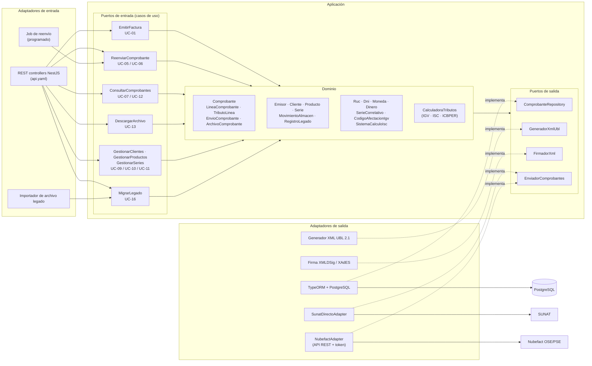

# Arquitectura Hexagonal objetivo

- **Entregable**: 2 — Diagramas de arquitectura MVC con visión a Hexagonal.
- **Decisión**: [ADR-0001](../adr/0001-mvc-con-vision-hexagonal.md), [ADR-0002](../adr/0002-envio-via-ose-o-sunat.md).
- **Relacionado con**: [arquitectura-mvc.md](./arquitectura-mvc.md), [evolucion-microservicios.md](./evolucion-microservicios.md).

## 1. Diagrama

El dominio queda al centro. Los puertos de entrada son los casos de uso; los puertos de salida son las interfaces que el dominio necesita. Los adaptadores están en el borde y dependen de los puertos.

Los repositorios del resto de agregados (`ClienteRepository`, `ProductoRepository`, `SerieRepository`, `MovimientoAlmacenRepository`, `RegistroLegadoRepository`) siguen el mismo patrón. Su definición está **Pendiente de definir** (modelo-dominio.md §5.2).

## 2. Puertos de entrada ↔ operaciones API

| Puerto de entrada | operationId (`api.yaml`) | UC |
|-------------------|--------------------------|----|
| `EmitirFactura` | `createInvoice` | UC-01 |
| `ReenviarComprobante` | `resendComprobante` (y job de reenvío) | UC-05, UC-06 |
| `ConsultarComprobantes` | `listComprobantes`, `getComprobante` | UC-07, UC-12 |
| `DescargarArchivo` | `downloadComprobanteFile` | UC-13, UC-15 |
| `GestionarClientes` | `createCustomer`, `listCustomers` | UC-09 |
| `GestionarProductos` | `createProduct`, `listProducts` | UC-10 |
| `GestionarSeries` | `createSeries`, `listSeries` | UC-11 |
| `MigrarLegado` | `startMigration`, `getMigration` | UC-16 |

## 3. Componente MVC hoy → componente hexagonal mañana

| Componente MVC hoy | Ubicación hoy (ADR-0001) | Componente hexagonal mañana | Cambio necesario |
|--------------------|--------------------------|-----------------------------|------------------|
| Vista React (Tauri) | `frontend/` | Cliente externo del adaptador REST | Ninguno |
| Controller NestJS | `modules/*/presentation/` | Adaptador de entrada REST | Ninguno; solo se reclasifica |
| Service de aplicación (`EmitirFacturaService`, …) | `modules/*/application/` | Puerto de entrada (caso de uso) + su implementación | Extraer una interfaz por caso de uso |
| Entidades de dominio, objetos de valor | `modules/*/domain/` | Núcleo del hexágono | Ninguno |
| `CalculadoraTributos` | `modules/comprobantes/domain/services/` | Servicio de dominio | Ninguno |
| Interfaces `ComprobanteRepository`, `GeneradorXmlUbl`, `FirmadorXml`, `EnviadorComprobantes` | `modules/*/domain/ports/` | Puertos de salida | Ninguno |
| Entidades TypeORM + repositorio | `modules/*/infrastructure/persistence/` | Adaptador de salida de persistencia | Ninguno |
| `SunatDirectoAdapter`, `NubefactAdapter` | `modules/comprobantes/infrastructure/envio/` | Adaptadores de salida de envío | Ninguno |
| Job de reenvío | `modules/comprobantes/infrastructure/envio/` | Adaptador de entrada (planificador) | Llamar al puerto `ReenviarComprobante` |
| Módulos NestJS (`ComprobantesModule`, …) | `modules/*` | Configuración de composición (cableado de puertos y adaptadores) | Ninguno |
