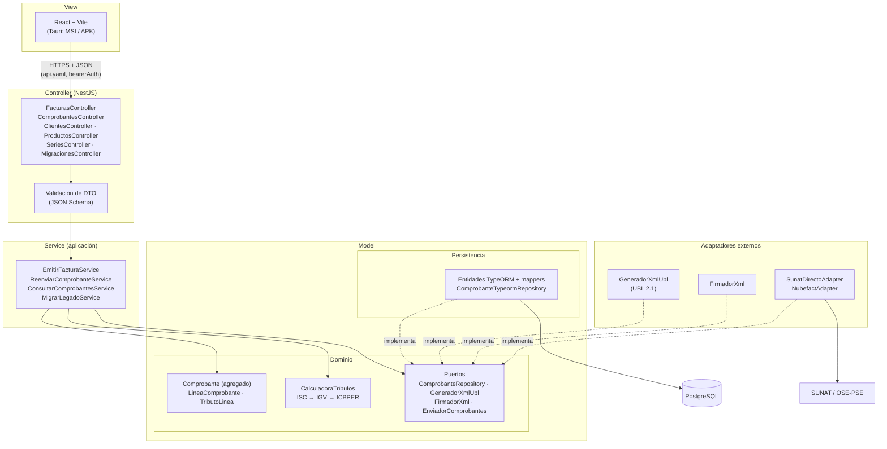

# Arquitectura MVC actual (monolito)

- **Entregable**: 2 — Diagramas de arquitectura MVC con visión a Hexagonal.
- **Decisión**: [ADR-0001](../adr/0001-mvc-con-vision-hexagonal.md) (MVC con puertos).
- **Relacionado con**: [arquitectura-hexagonal.md](./arquitectura-hexagonal.md), [modelo-dominio.md](../domain/modelo-dominio.md), [api.yaml](../contracts/api.yaml).

## 1. Capas

| Capa MVC | Componente | Ubicación prevista | Responsabilidad |
|----------|-----------|--------------------|-----------------|
| **View** | React + Vite, empaquetado con Tauri (MSI/APK, ADR-0003) | `frontend/` | Formularios y consultas; llama a la API REST. |
| **Controller** | Controladores NestJS (`FacturasController`, `ComprobantesController`, …) | `backend/src/modules/*/presentation/` | Valida el DTO (`specs/contracts/schemas/`), llama al servicio y traduce errores a 400/409/422. |
| **Service** | Servicios de aplicación (`EmitirFacturaService`, `ReenviarComprobanteService`, …) | `backend/src/modules/*/application/` | Orquesta el caso de uso; no contiene reglas tributarias. |
| **Model — dominio** | Agregados, objetos de valor, `CalculadoraTributos`, puertos | `backend/src/modules/*/domain/` | Reglas e invariantes (INV-01 a INV-16). Sin dependencias de framework. |
| **Model — persistencia** | Entidades TypeORM, mappers, repositorios | `backend/src/modules/*/infrastructure/persistence/` | Implementa `ComprobanteRepository` sobre PostgreSQL. |
| Adaptadores externos | Generador XML UBL, firmador, SUNAT directo, Nubefact | `backend/src/modules/*/infrastructure/` | Implementan `GeneradorXmlUbl`, `FirmadorXml`, `EnviadorComprobantes`. |

## 2. Diagrama de flujo de capas



Las flechas punteadas indican "implementa": la infraestructura depende del dominio, nunca al revés.

## 3. Secuencia: Emitir factura (UC-01, FR-1 a FR-12)

Canal `SUNAT_DIRECTO` (con `OSE_PSE` por trama se omiten la generación y la firma del XML; ver ADR-0002).

```mermaid
sequenceDiagram
    autonumber
    actor U as Vendedor/cajero
    participant V as Vista React
    participant C as FacturasController
    participant S as EmitirFacturaService
    participant CT as CalculadoraTributos
    participant D as Comprobante
    participant R as ComprobanteRepository
    participant G as GeneradorXmlUbl
    participant F as FirmadorXml
    participant E as EnviadorComprobantes
    participant X as SUNAT / OSE

    U->>V: Completa la factura
    V->>C: POST /api/v1/comprobantes/facturas (createInvoice)
    C->>C: Valida create-invoice.request.schema.json
    alt DTO inválido (RUC, Cat. 07, ISC sin Cat. 08)
        C-->>V: 400 error.response (FR-11)
    end
    C->>S: emitirFactura(comando)
    S->>R: siguienteCorrelativo(serie) o verifica el correlativo recibido
    alt Correlativo ya usado
        S-->>C: CorrelativoDuplicado
        C-->>V: 409 error.response (INV-04)
    end
    loop Cada línea
        S->>CT: calcularIsc(línea) (Cat. 08, Cat. 05 2000)
        CT-->>S: ISC (o ninguno)
        S->>CT: calcularIgv(línea, ISC) (base = valor de venta + ISC; 18 % si Cat. 07 10)
        CT-->>S: IGV (Cat. 05 1000)
        S->>CT: calcularIcbper(línea) (Cat. 05 7152)
        CT-->>S: ICBPER (o ninguno)
    end
    S->>CT: calcularTotales(líneas)
    CT-->>S: Totales (INV-12)
    S->>D: crear(BORRADOR) y emitir()
    alt Regla tributaria o de negocio incumplida
        D-->>S: Error de dominio
        S-->>C: Error
        C-->>V: 422 error.response
    end
    D-->>S: Estado PENDIENTE_ENVIO
    S->>G: generar(comprobante)
    G-->>S: XML Invoice UBL 2.1
    S->>F: firmar(xml, certificadoRef)
    F-->>S: XML firmado (ext:UBLExtensions, cac:Signature)
    S->>R: guardar(comprobante + ArchivoComprobante XML)
    S->>E: enviar(xmlFirmado, comprobante)
    E->>X: Envío
    alt CDR de aceptación
        X-->>E: CDR (cbc:ResponseCode)
        E-->>S: RespuestaEnvio ACEPTADO + CDR
        S->>D: registrarEnvio(...) → ACEPTADO
    else CDR de rechazo
        X-->>E: CDR
        E-->>S: RespuestaEnvio RECHAZADO + CDR
        S->>D: registrarEnvio(...) → RECHAZADO
    else Sin respuesta (timeout / caída)
        X--xE: Sin respuesta
        E-->>S: RespuestaEnvio SIN_RESPUESTA
        S->>D: registrarEnvio(...) → se mantiene PENDIENTE_ENVIO
        Note over S,R: Queda en la cola de reenvío (UC-06, ADR-0002)
    end
    S->>R: guardar(comprobante + EnvioComprobante [+ CDR])
    S-->>C: Comprobante
    C-->>V: 201 invoice.response (status)
    Note over S: La generación del PDF no bloquea la emisión (NFR de rendimiento)
```
