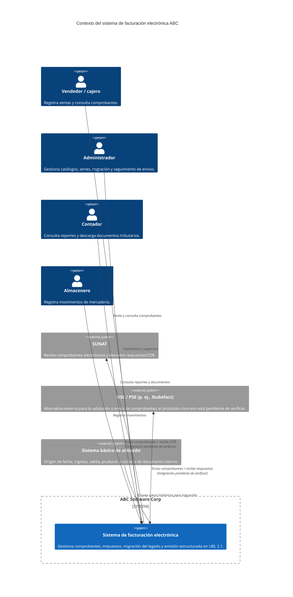

# C4 — Diagrama de contexto

Contexto del sistema y sus usuarios, canales de operación e integraciones externas. Es un diagrama de nivel Contexto (C1); no define protocolos ni detalles de despliegue.

La selección entre envío directo a SUNAT y un proveedor OSE/PSE se registra en [ADR-0002](../adr/0002-envio-via-ose-o-sunat.md). El diagrama no implica que exista ya una integración implementada.
