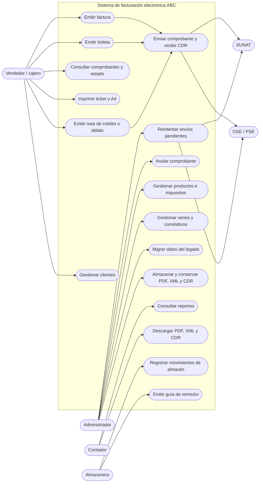

# Diagrama de casos de uso

Alcance funcional de los casos de uso identificados para el sistema de facturación y almacén. Las relaciones con SUNAT/OSE aplican a las operaciones de emisión y envío.

Los nombres y actores corresponden a UC-01–UC-18 de [casos-de-uso.md](../use-cases/casos-de-uso.md). Los casos de emisión de notas y guías se mantienen en el mapa de alcance; sus reglas normativas todavía requieren verificación.
