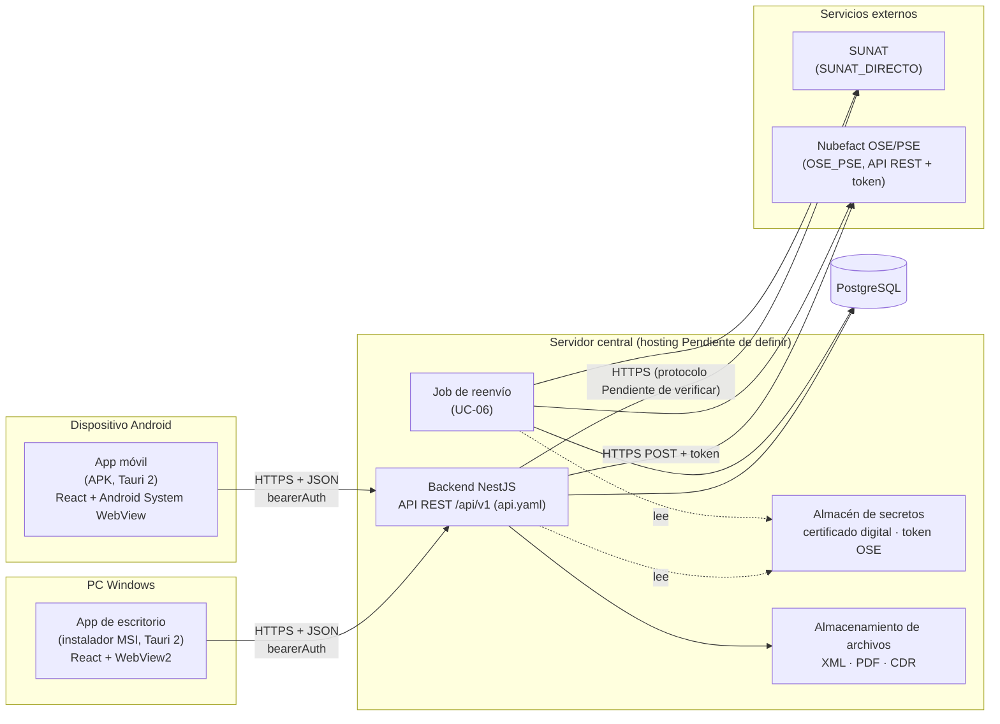

# Diagrama de despliegue

- **Entregable**: 2 — Diagramas de arquitectura MVC con visión a Hexagonal.
- **Decisión**: [ADR-0003](../adr/0003-empaquetado-msi-apk.md) (Tauri 2, servidor central), [ADR-0002](../adr/0002-envio-via-ose-o-sunat.md) (canal de envío).

## 1. Diagrama

## 2. Nodos

| Nodo | Contenido | Notas |
|------|-----------|-------|
| PC Windows | App Tauri instalada con MSI | Requiere WebView2; versión mínima de Windows: **Pendiente de verificar**. No guarda certificados ni tokens. |
| Dispositivo Android | App Tauri instalada con APK | Versión mínima de Android: **Pendiente de verificar**. No guarda certificados ni tokens. |
| Backend NestJS | API REST, servicios de aplicación, dominio, adaptadores | Único punto que asigna correlativos (INV-04) y que firma o delega el envío. |
| Job de reenvío | Proceso programado del backend | Reintenta los comprobantes `PENDIENTE_ENVIO` / `ENVIADO` (ADR-0002). |
| Almacén de secretos | Certificado digital, token Nubefact, credenciales SUNAT | Producto concreto: **Pendiente de definir**. |
| Almacenamiento de archivos | XML firmado, PDF, CDR (`ArchivoComprobante.ubicacion`) | Plazo de conservación: **Pendiente de verificar** (UC-14). |
| PostgreSQL | Datos de todos los agregados | Copias de seguridad y réplica: **Pendiente de definir**. |
| SUNAT / Nubefact | Destinos de envío | Se elige uno por configuración (`ENVIO_CANAL`). |

## 3. Conectividad

- Cliente sin conexión al servidor: no puede emitir; solo consulta datos cargados y prepara borradores (ADR-0003).
- Servidor sin respuesta de SUNAT/OSE: el comprobante queda en `PENDIENTE_ENVIO` y el job lo reintenta (FR-10, UC-06).
