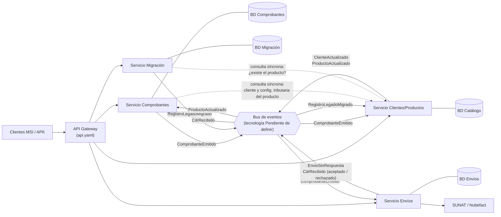

# Evolución hacia microservicios

- **Entregable**: 2 — Diagramas de arquitectura MVC con visión a Hexagonal.
- **Decisión**: [ADR-0001](../adr/0001-mvc-con-vision-hexagonal.md) (agregados con referencias por id y puertos).
- **Relacionado con**: [arquitectura-hexagonal.md](./arquitectura-hexagonal.md), [modelo-dominio.md](../domain/modelo-dominio.md).

Es una visión de futuro, no una decisión de implementación. Se aplicará cuando la carga o el equipo lo justifiquen.

## 1. Servicios y agregados

| Servicio | Agregados / entidades que posee | Base de datos propia | Puertos que ya existen hoy |
|----------|--------------------------------|----------------------|----------------------------|
| **Comprobantes** | `Comprobante` (`LineaComprobante`, `TributoLinea`, `ArchivoComprobante`), `Serie`, `Emisor`, `CalculadoraTributos` | Sí | `ComprobanteRepository`, `GeneradorXmlUbl`, `FirmadorXml` |
| **Clientes/Productos** (catálogo e inventario) | `Cliente`, `Producto`, `MovimientoAlmacen` | Sí | Repositorios de catálogo (**Pendiente de definir**) |
| **Envíos** | `EnvioComprobante`, cola de reenvío, adaptadores SUNAT/Nubefact | Sí | `EnviadorComprobantes` |
| **Migración** | `RegistroLegado` | Sí (puede retirarse tras la migración) | `RegistroLegadoRepository` (**Pendiente de definir**) |

Cambio respecto del monolito: hoy `EnvioComprobante` es entidad interna del agregado `Comprobante`. Al separar Envíos, pasa a ser propiedad del servicio de Envíos, y el agregado `Comprobante` solo guarda su `estado`, que se actualiza por eventos. `MovimientoAlmacen` ya referencia `comprobanteId` y `registroLegadoId` por id, así que no requiere cambios.

## 2. Diagrama

## 3. Comunicación

### Eventos (asíncronos)

| Evento | Publica | Consume | Efecto |
|--------|---------|---------|--------|
| `ComprobanteEmitido` | Comprobantes | Envíos | Encola el envío (UC-05). |
| `ComprobanteEmitido` | Comprobantes | Clientes/Productos | Registra `MovimientoAlmacen` de `SALIDA` con `origen = COMPROBANTE` (UC-17). |
| `EnvioSinRespuesta` | Envíos | — (auditoría / alertas) | El comprobante sigue en `PENDIENTE_ENVIO`; Envíos reintenta (UC-06). |
| `CdrRecibido` | Envíos | Comprobantes | Cambia el estado a `ACEPTADO` o `RECHAZADO` (FR-10, INV-15) y registra el CDR como `ArchivoComprobante`. |
| `RegistroLegadoMigrado` | Migración | Clientes/Productos | Crea los `MovimientoAlmacen` con `origen = MIGRACION` (UC-16). |
| `ClienteActualizado`, `ProductoActualizado` | Clientes/Productos | Comprobantes | Actualiza copias de lectura; los comprobantes emitidos no cambian (`datosCliente` inmutable, INV-13). |

### Consultas síncronas

- Comprobantes → Clientes/Productos: datos del cliente y configuración tributaria del producto al emitir.
- Migración → Clientes/Productos: validar que el producto existe (`PRODUCTO_INEXISTENTE`).

### Garantías

- Publicación fiable con patrón *outbox* (el evento se guarda en la misma transacción que el cambio de estado).
- Consumidores idempotentes (clave: id del comprobante + número de intento).
- Tecnología del bus, formato de eventos y versionado: **Pendiente de definir**.

## 4. Orden sugerido de extracción

1. **Monolito MVC con puertos** (hoy, ADR-0001).
2. **Monolito modular hexagonal**: mismos módulos, con puertos de entrada explícitos.
3. **Envíos**: primero, porque depende de sistemas externos, tiene reintentos y su carga es distinta.
4. **Migración**: proceso por lotes, temporal y aislado.
5. **Clientes/Productos**: cuando el inventario crezca o lo use otro sistema.
