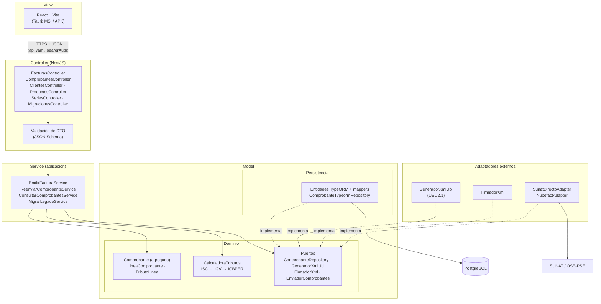
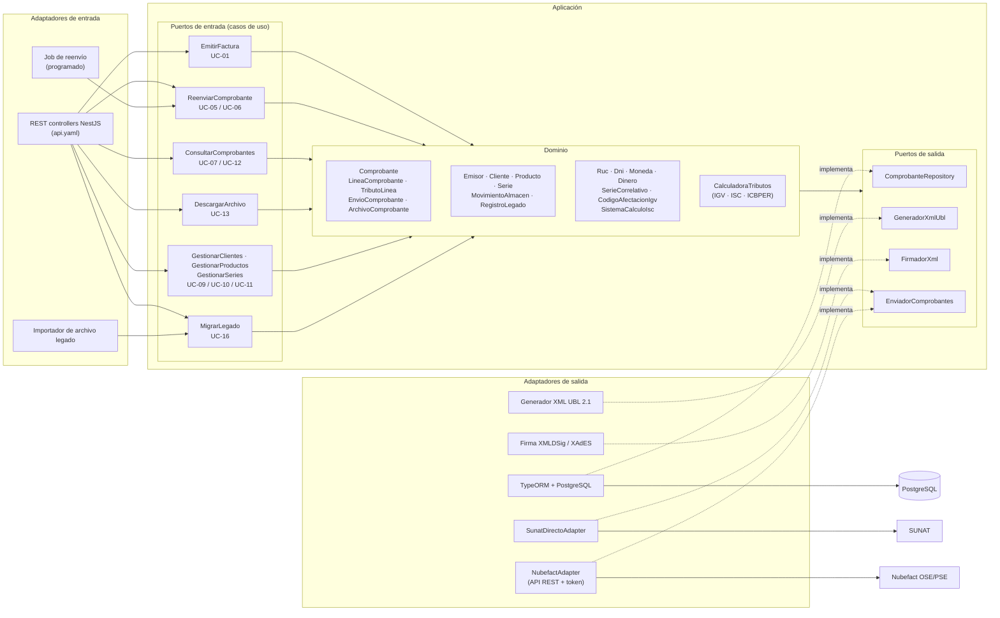
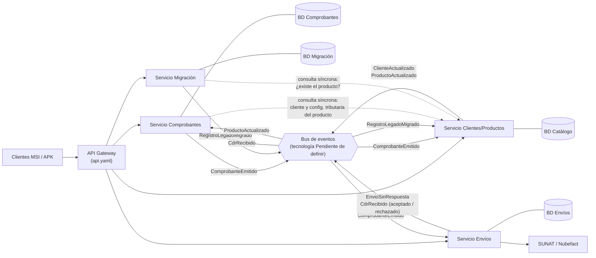
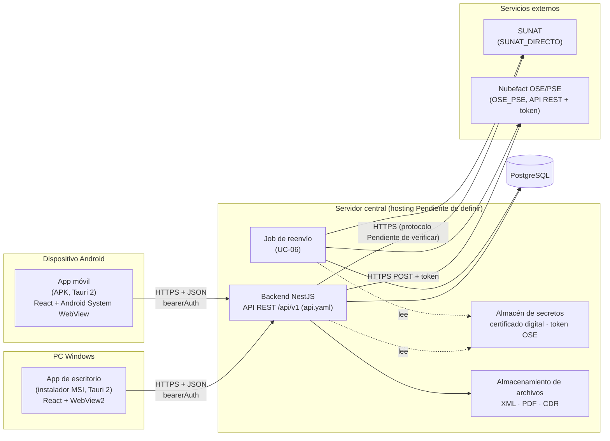
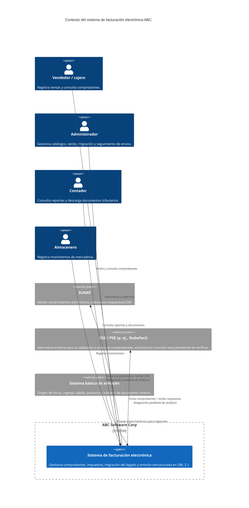
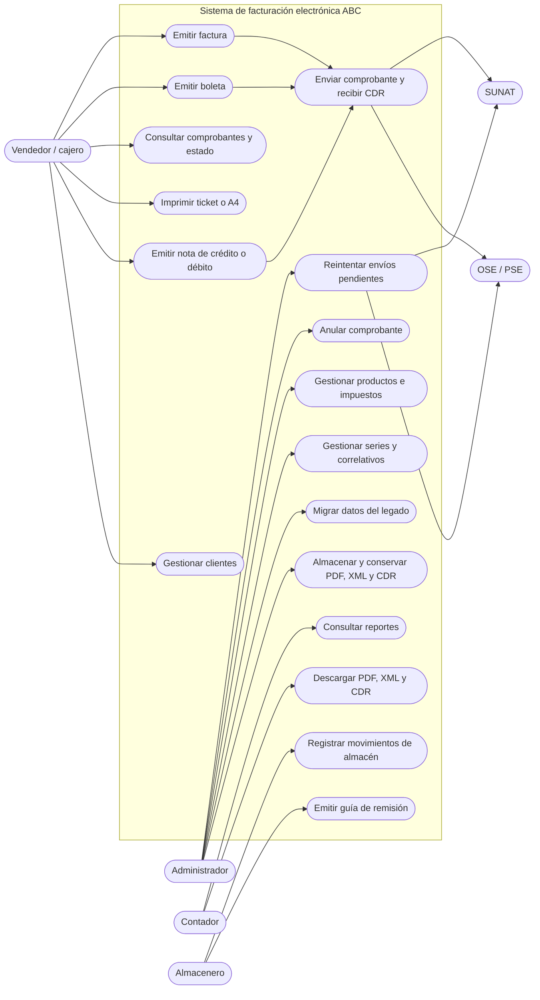

# Facturación electrónica SUNAT UBL 2.1 – ABC Software Corp

**Curso:** Arquitectura de Software  
**Evaluación:** Examen de medio curso  
**Autora:** Campos Flores Elida Andrea  
**Fecha:** 12 de noviembre de 2026  
**Entrega:** Fase 1 — especificaciones (SDD)

---

## 1. Introducción y objetivo

ABC Software Corp es una empresa mediana que comercializa abarrotes y mercadería al por mayor y menor. El caso describe un sistema de almacén básico que conserva fecha, ingreso, salida, producto y un número de documento interno. La necesidad planteada es evolucionar hacia un sistema que estructure comprobantes electrónicos en UBL, valide datos y tributos, genere XML firmado y se comunique con SUNAT u Operadores/Proveedores de Servicios Electrónicos.

El objetivo de esta primera fase es definir las especificaciones antes de implementar lógica de negocio: modelo de dominio, reglas y validaciones, contratos de datos y API, casos de uso, decisiones arquitectónicas y trazabilidad entre catálogos SUNAT y UBL. La fase también debe conservar la información histórica con trazabilidad y preparar una solución que pueda distribuirse en Windows y Android. Este informe consolida los artefactos documentales existentes; no afirma que las funcionalidades estén implementadas ni que exista certificación de cumplimiento.

Fuente principal: [caso-de-estudio.md](../caso-de-estudio.md).

## 2. Análisis del caso

El diagnóstico se basa en lo descrito por el caso y no constituye una auditoría del software en ejecución.

| Brecha observada | Consecuencia para el diseño |
|---|---|
| El legado conserva movimientos básicos y la semántica real de sus datos no se conoce todavía. | Conservar una copia fiel de cada fila, mapearla a movimientos con trazabilidad y dejar los datos ambiguos en revisión. El número interno no se interpreta como comprobante SUNAT. |
| El caso reporta ausencia de validación de RUC. | Separar controles de formato de las consultas o comprobaciones oficiales; el algoritmo y las fuentes de validación están por verificar. |
| Los cálculos de IGV, ISC e ICBPER son incompletos o incorrectos según el caso. | Especificar afectación por línea, bases, parámetros, redondeos y la interacción entre tributos; las reglas fiscales vigentes deben contrastarse antes de implementarse. |
| No se genera XML firmado ni se comunica con SUNAT/OSE. | Documentar generación estructurada, firma, envío, respuesta/CDR, estados y reintentos, manteniendo separados el dominio y los adaptadores. |
| No está documentada la relación entre ventas, comprobantes y movimientos físicos de inventario. | Mantener referencias trazables entre comprobante, líneas, movimientos y datos históricos; confirmar si los formatos de libros son aplicables al contribuyente. |
| No se conocen formato, calidad, identificadores ni codificación de los datos reales del legado. | Perfilar una muestra real antes de definir reglas definitivas de migración y conciliación. |

El análisis clasifica como de confianza alta las afirmaciones observables en el enunciado o una fuente primaria consultada; media, las interpretaciones de diseño; y baja, las hipótesis sin evidencia suficiente. La confianza expresa solidez de la evidencia, no obligatoriedad legal. Véase [01-analisis-del-caso.md](./01-analisis-del-caso.md).

## 3. Marco normativo

El marco de trabajo considera la RS N.° 097-2012/SUNAT, la RS N.° 234-2006/SUNAT y UBL 2.1. El análisis documental no es dictamen legal: se debe revisar el texto consolidado, sus modificaciones, anexos y la aplicabilidad al contribuyente antes de cerrar las reglas.

| Fuente | Aporte recogido en la fase 1 | Confianza y límite |
|---|---|---|
| RS N.° 097-2012/SUNAT, texto publicado por SUNAT | Referencia para el Sistema de Emisión Electrónica desarrollado desde los sistemas del contribuyente. El caso deriva de allí la necesidad de emitir, firmar y comunicar comprobantes. | Alta para la denominación y texto consultado; media para los requisitos derivados. Vigencia consolidada, artículos aplicables, protocolo y plazos requieren verificación. |
| RS N.° 234-2006/SUNAT, texto publicado por SUNAT | Referencia para libros y registros vinculados a asuntos tributarios. Se identifican los formatos 14.1, Registro de Ventas e Ingresos, y 12.1, Registro del Inventario Permanente en Unidades Físicas. | Alta para las denominaciones observadas; la aplicabilidad actual a ABC Software Corp, campos vigentes y medios de llevado no se han confirmado. |
| OASIS UBL 2.1 y XSD local | Define vocabulario XML genérico, estructura, orden y cardinalidades de los documentos. Se revisó `Invoice` y se agregaron referencias locales para `CreditNote` y `DebitNote`. | Alta para estructura XSD. Un XML válido contra UBL no demuestra conformidad con el perfil SUNAT ni aceptación de SUNAT/OSE. |
| Catálogos SUNAT de referencia del proyecto | Aportan los códigos y mapeos usados como base de contratos y modelo. | Media como insumo documental; deben cotejarse con el anexo oficial vigente. |

Por tanto, el XSD se utiliza para validar nombres, tipos y cardinalidades, no para deducir tasas, códigos SUNAT, obligación legal, reglas de firma o aceptación. Las fuentes y sus límites se desarrollan en [02-marco-normativo.md](./02-marco-normativo.md).

## 4. Investigación de mercado: Nubefact

La investigación se hizo con documentación oficial de integración API REST y una síntesis de reseñas de usuarios. No se pudo crear una cuenta DEMO porque el registro requería un RUC activo.

Según la documentación del proveedor revisada, Nubefact ofrece emisión de facturas, boletas, notas y guías; consultas filtradas; y descarga de PDF, XML y CDR. La integración descrita utiliza HTTP POST a una URL asignada, token por entorno y una trama JSON o TXT con emisor, cliente, ítems, impuestos y totales. El flujo indicado por las notas de investigación es que la plataforma procesa la trama, produce XML/PDF, despacha y valida el comprobante y almacena la CDR.

Las reseñas consultadas destacan acompañamiento técnico y resolución de incidencias. Son observaciones cualitativas, no una evaluación independiente del servicio. Los riesgos sectoriales de demoras, interrupciones, personalización o soporte que aparecen en las notas no proceden de esas reseñas y continúan pendientes de verificar; no se atribuyen a Nubefact. También están pendientes la fuente exacta de la afirmación de ISO 27001, la especificación de la trama y el alcance jurídico vigente de las acreditaciones PSE/OSE.

La investigación contribuye requisitos de integración configurable, protección de tokens, consulta y descarga de documentos, registro de CDR y reintentos. Fuente: [investigacion-nubefact.md](../use-cases/investigacion-nubefact.md).

## 5. Casos de uso

Las prioridades son preliminares y no representan un calendario comprometido. Se resumen los 18 casos documentados en [casos-de-uso.md](../use-cases/casos-de-uso.md).

| ID | Caso de uso | Actor principal | Propósito / observación |
|---|---|---|---|
| UC-01 | Emitir factura electrónica | Vendedor/cajero | Preparar factura UBL 2.1 (Cat. 01 `01`) para validación y envío. |
| UC-02 | Emitir boleta electrónica | Vendedor/cajero | Preparar boleta UBL 2.1 (Cat. 01 `03`) para validación y envío. |
| UC-03 | Emitir nota de crédito | Vendedor/cajero | Registrar nota vinculada al comprobante de origen; motivo Cat. 09 (01–13). |
| UC-04 | Emitir nota de débito | Vendedor/cajero | Registrar nota vinculada al comprobante de origen; motivo Cat. 10 (01–03). |
| UC-05 | Enviar comprobante y recibir CDR | Sistema de emisión | Enviar a SUNAT u OSE/PSE y asociar la respuesta recibida. |
| UC-06 | Reintentar envíos pendientes | Administrador | Reintentar fallas de comunicación conservando el estado y los intentos. |
| UC-07 | Consultar estado de comprobante | Vendedor/cajero | Consultar envío y respuesta sin presumir aceptación. |
| UC-08 | Anular comprobante | Administrador | Comunicación de baja para facturas y resumen diario para boletas; detalles pendientes. |
| UC-09 | Gestionar clientes | Vendedor/cajero | Registrar/buscar clientes y validar formatos documentarios definidos. |
| UC-10 | Gestionar productos e impuestos | Administrador | Configurar afectación Cat. 07 y, si aplica, sistema ISC Cat. 08. |
| UC-11 | Gestionar series y correlativos | Administrador | Configurar numeración de comprobantes; secuencia y unicidad pendientes de verificar. |
| UC-12 | Consultar y generar reportes | Contador | Consultar comprobantes por filtros de negocio. |
| UC-13 | Descargar PDF, XML y CDR | Contador | Obtener los archivos disponibles de un comprobante. |
| UC-14 | Almacenar y conservar archivos | Administrador | Conservar PDF, XML y CDR; plazo legal pendiente de verificar. |
| UC-15 | Imprimir Ticket/A4 | Vendedor/cajero | Obtener una representación impresa. |
| UC-16 | Migrar datos del legado | Administrador | Importar los cinco campos históricos conservando trazabilidad. |
| UC-17 | Registrar movimientos de almacén | Almacenero | Registrar ingresos y salidas de productos. |
| UC-18 | Emitir guía de remisión | Almacenero | Preparar guía electrónica; tipos y reglas pendientes de verificar. |

## 6. Especificación de funcionalidades

Las cuatro features siguen en estado Draft y describen contratos y comportamiento esperado, no código implementado.

### 6.1 FEAT-001 — Emisión de factura

**Objetivo:** validar y registrar una factura antes de enviarla a SUNAT/OSE. Requisitos principales: Catálogo 01 código `01`; cliente RUC Catálogo 06 código `6`; serie `F` más tres caracteres alfanuméricos; moneda `PEN`/`USD`; afectación Cat. 07; sistema ISC Cat. 08 y tributos Cat. 05; cálculo IGV/ISC/ICBPER; estados de envío y errores claros. Tasas, reglas de redondeo, validación del dígito verificador y varios mapeos UBL siguen pendientes.

```gherkin
Scenario: Emitir factura válida con producto gravado
  Given un cliente con RUC de 11 dígitos y tipo Catálogo 06 código "6"
  And una serie "F001", moneda "PEN" y una línea Catálogo 07 código "10" por 100.00
  When se emite una factura Catálogo 01 código "01"
  Then el IGV calculado es 18.00 y el total es 118.00

Scenario: Calcular IGV sobre valor de venta más ISC
  Given una línea con valor de venta 100.00 e ISC configurado que produce 10.00
  When se calculan los tributos
  Then la base IGV es 110.00 y el IGV es 19.80
```

Fuente: [001-emitir-factura.md](../features/001-emitir-factura.md).

### 6.2 FEAT-002 — Emisión de boleta

**Objetivo:** emitir boleta UBL para ventas minoristas. Requisitos principales: Catálogo 01 código `03`; serie `B` más tres alfanuméricos; cliente con DNI Cat. 06 `1` o sin documento (supuesto provisional: Cat. 06 `0`); uso de moneda e impuestos; ICBPER Cat. 05 `7152`; envío y estado pendiente si no hay respuesta. El código oficial del cliente sin documento y el monto unitario ICBPER están pendientes.

```gherkin
Scenario: Emitir boleta para cliente con DNI
  Given DNI de 8 dígitos, Catálogo 06 código "1", serie "B001" y moneda "PEN"
  When se emite una boleta Catálogo 01 código "03"
  Then la solicitud registra el tipo de documento "1" y calcula los tributos

Scenario: Calcular ICBPER por bolsas plásticas
  Given una línea que informa la cantidad de bolsas y existe monto unitario configurado
  When se calculan los tributos
  Then el ICBPER se identifica con Catálogo 05 código "7152"
```

Fuente: [002-emitir-boleta.md](../features/002-emitir-boleta.md).

### 6.3 FEAT-003 — Notas de crédito y débito

**Objetivo:** emitir `CreditNote` o `DebitNote` asociada obligatoriamente a un comprobante original. El request conserva un identificador interno del original, motivo y líneas; la emisión debe resolver la referencia UBL y usar el documento/totales correspondientes. El motivo se valida con los Catálogos 09 y 10 y va en `cac:DiscrepancyResponse/cbc:ResponseCode`; las reglas de importes por motivo siguen pendientes.

```gherkin
Scenario: Emitir nota de crédito vinculada al original
  Given que existe un comprobante original y se proporciona el motivo "07" (devolución por ítem) del Catálogo 09
  When se solicita una nota de crédito con líneas válidas
  Then se prepara un UBL CreditNote con referencia al original

Scenario: Emitir nota de débito vinculada al original
  Given que existe un comprobante original y se proporciona el motivo "01" (intereses por mora) del Catálogo 10
  When se solicita una nota de débito con líneas válidas
  Then se prepara un UBL DebitNote con referencia al original
```

Fuente: [003-emitir-nota-credito-debito.md](../features/003-emitir-nota-credito-debito.md).

### 6.4 FEAT-004 — Anulación de comprobante

**Objetivo:** gestionar la solicitud y el resultado sin presentar una solicitud recibida como anulación confirmada. La feature enruta factura a comunicación de baja y boleta a resumen diario; plazos, catálogo, reglas de elegibilidad y estructura normativa están pendientes.

```gherkin
Scenario: Preparar comunicación de baja para factura
  Given una factura elegible
  When el administrador solicita su anulación
  Then se selecciona comunicación de baja y se registra la solicitud

Scenario: Preparar resumen diario para boleta
  Given una boleta elegible y sin respuesta válida de SUNAT/OSE
  When el administrador solicita su anulación
  Then se selecciona resumen diario y el comprobante no se marca ANULADO
```

Fuente: [004-anular-comprobante.md](../features/004-anular-comprobante.md).

## 7. Modelo de dominio y catálogos SUNAT

El modelo organiza los datos en agregados separados: `Comprobante`, `Emisor`, `Cliente`, `Producto`, `Serie`, `MovimientoAlmacen` y `RegistroLegado`. El comprobante contiene líneas, tributos, envíos y archivos. Los objetos de valor incluyen RUC, DNI, moneda, dinero, serie/correlativo, afectación IGV y sistema de cálculo ISC. El estado registra preparación, envío, aceptación, rechazo y anulación; aceptar o rechazar requiere CDR, y anular requiere confirmación.

La migración conserva cada fila original como `RegistroLegado`, con hash y estado de revisión. Puede originar movimientos de ingreso/salida; `nro_documento` se mantiene como documento interno y no se convierte en `cbc:ID` tributario.

| Catálogo / código | Significado resumido | Uso documentado |
|---|---|---|
| Catálogo 01 | `01` factura; `03` boleta; `07` nota de crédito; `08` nota de débito; `09` guía de remisión remitente. | `cbc:InvoiceTypeCode`; para notas el documento UBL es `CreditNote`/`DebitNote`. Verificado con el Anexo E de la RS N.° 245-2017/SUNAT. |
| Catálogo 05 | `1000` IGV; `1016` IVAP; `2000` ISC; `7152` ICBPER; `9995` exportación; `9996` gratuito; `9997` exonerado; `9998` inafecto; `9999` otros tributos. | `cac:TaxScheme/cbc:ID`, con nombre en `cbc:Name` y código internacional UN/ECE en `cbc:TaxTypeCode`. Verificado con el Anexo VI de la RS N.° 150-2019/SUNAT; se agregaron `1016` y `9999`. |
| Catálogo 06 | `0` doc. tributario de no domiciliado sin RUC; `1` DNI; `4` carnet de extranjería; `6` RUC; `7` pasaporte. | Tipo de identificación del cliente; factura exige RUC en FEAT-001 y boleta admite DNI o sin documento en FEAT-002. Al contrastar con el anexo oficial (RS 245-2017) se corrigió el significado del código `0`; el código para boleta sin documento sigue pendiente. |
| Catálogo 07 | Afectaciones IGV: gravadas `10`–`17`, exoneradas `20`–`21`, inafectas `30`–`36` y exportación `40`. | `cbc:TaxExemptionReasonCode`. Los 18 códigos coinciden con el Anexo E de la RS N.° 245-2017/SUNAT. |
| Catálogo 08 | `01` sistema al valor; `02` monto fijo; `03` precios de venta al público. | `cbc:TierRange`. Verificado con el Anexo E de la RS N.° 245-2017/SUNAT. |
| Catálogo 09 | `01` anulación de la operación; `02` anulación por error en el RUC; `03` corrección de descripción o atención de reclamo; `04`/`05` descuento global/por ítem; `06`/`07` devolución total/por ítem; `08` bonificación; `09` disminución en el valor; `10` otros conceptos; `11` ajustes de exportación; `12` ajustes afectos al IVAP; `13` corrección del monto pendiente o de las cuotas de pago. | Motivo de la nota de crédito en `CreditNote/cac:DiscrepancyResponse/cbc:ResponseCode`. Verificado con el Anexo IV de la RS N.° 000165-2021/SUNAT. |
| Catálogo 10 | `01` intereses por mora; `02` aumento en el valor; `03` penalidades/otros conceptos. | Motivo de la nota de débito en `DebitNote/cac:DiscrepancyResponse/cbc:ResponseCode`. Verificado con el Anexo E de la RS N.° 245-2017/SUNAT y la guía XML de nota de débito; códigos posteriores a 2017 por verificar. |

Regla tributaria de trabajo recogida por el proyecto: para una línea con ISC, la base de IGV es `valor de venta + ISC`; para Cat. 07 código `10`, se propone IGV de 18 %. El cálculo de ISC se realiza antes del IGV porque el IGV depende de esa base. Tasas ISC, parámetros, redondeos, correspondencia de todos los códigos y vigencia deben verificarse; la regla no se presenta como certificación fiscal. Fuente: [modelo-dominio.md](../domain/modelo-dominio.md) y [catalogos-sunat.md](../domain/catalogos-sunat.md).

## 8. Arquitectura

### 8.1 MVC con visión hexagonal

La arquitectura objetivo inmediata es un monolito MVC: vista React/Vite empaquetada con Tauri; controladores NestJS reciben DTO y llaman servicios de aplicación; el dominio contiene agregados e invariantes; TypeORM/PostgreSQL y los conectores externos son infraestructura. Los servicios orquestan, pero las reglas tributarias se mantienen en el dominio.

La visión hexagonal hace explícitos los puertos de entrada (casos de uso) y salida. Entre los puertos de salida están `ComprobanteRepository`, `GeneradorXmlUbl`, `FirmadorXml` y `EnviadorComprobantes`. Los adaptadores previstos incluyen TypeORM/PostgreSQL, generación UBL, firma XMLDSig/XAdES, envío directo a SUNAT y Nubefact. El dominio no depende de NestJS, TypeORM ni clientes HTTP.

### 8.2 Diagramas Mermaid existentes

Los siguientes bloques reproducen los diagramas Mermaid de `specs/diagrams/`. Se conservan como fuente Mermaid; el comando Pandoc solicitado los incorpora al documento Word como bloques de código, no los renderiza automáticamente como gráficos.

#### MVC: capas y dependencias



#### MVC: secuencia de emisión de factura

```mermaid
sequenceDiagram
    autonumber
    actor U as Vendedor/cajero
    participant V as Vista React
    participant C as FacturasController
    participant S as EmitirFacturaService
    participant CT as CalculadoraTributos
    participant D as Comprobante
    participant R as ComprobanteRepository
    participant G as GeneradorXmlUbl
    participant F as FirmadorXml
    participant E as EnviadorComprobantes
    participant X as SUNAT / OSE

    U->>V: Completa la factura
    V->>C: POST /api/v1/comprobantes/facturas (createInvoice)
    C->>C: Valida create-invoice.request.schema.json
    alt DTO inválido (RUC, Cat. 07, ISC sin Cat. 08)
        C-->>V: 400 error.response (FR-11)
    end
    C->>S: emitirFactura(comando)
    S->>R: siguienteCorrelativo(serie) o verifica el correlativo recibido
    alt Correlativo ya usado
        S-->>C: CorrelativoDuplicado
        C-->>V: 409 error.response (INV-04)
    end
    loop Cada línea
        S->>CT: calcularIsc(línea) (Cat. 08, Cat. 05 2000)
        CT-->>S: ISC (o ninguno)
        S->>CT: calcularIgv(línea, ISC) (base = valor de venta + ISC; 18 % si Cat. 07 10)
        CT-->>S: IGV (Cat. 05 1000)
        S->>CT: calcularIcbper(línea) (Cat. 05 7152)
        CT-->>S: ICBPER (o ninguno)
    end
    S->>CT: calcularTotales(líneas)
    CT-->>S: Totales (INV-12)
    S->>D: crear(BORRADOR) y emitir()
    alt Regla tributaria o de negocio incumplida
        D-->>S: Error de dominio
        S-->>C: Error
        C-->>V: 422 error.response
    end
    D-->>S: Estado PENDIENTE_ENVIO
    S->>G: generar(comprobante)
    G-->>S: XML Invoice UBL 2.1
    S->>F: firmar(xml, certificadoRef)
    F-->>S: XML firmado (ext:UBLExtensions, cac:Signature)
    S->>R: guardar(comprobante + ArchivoComprobante XML)
    S->>E: enviar(xmlFirmado, comprobante)
    E->>X: Envío
    alt CDR de aceptación
        X-->>E: CDR (cbc:ResponseCode)
        E-->>S: RespuestaEnvio ACEPTADO + CDR
        S->>D: registrarEnvio(...) → ACEPTADO
    else CDR de rechazo
        X-->>E: CDR
        E-->>S: RespuestaEnvio RECHAZADO + CDR
        S->>D: registrarEnvio(...) → RECHAZADO
    else Sin respuesta (timeout / caída)
        X--xE: Sin respuesta
        E-->>S: RespuestaEnvio SIN_RESPUESTA
        S->>D: registrarEnvio(...) → se mantiene PENDIENTE_ENVIO
        Note over S,R: Queda en la cola de reenvío (UC-06, ADR-0002)
    end
    S->>R: guardar(comprobante + EnvioComprobante [+ CDR])
    S-->>C: Comprobante
    C-->>V: 201 invoice.response (status)
    Note over S: La generación del PDF no bloquea la emisión (NFR de rendimiento)
```

#### Arquitectura hexagonal



#### Evolución futura a microservicios



La separación en servicios y el bus son una visión futura, no una decisión de implementación para la fase 1. La tecnología de mensajería está pendiente de definir.

#### Despliegue objetivo



El backend central concentra secretos y asignación de correlativos; los clientes no emiten sin conexión al servidor. Versiones mínimas de plataforma, hosting, almacenamiento, respaldos y toolchain siguen pendientes.

#### C4 de contexto



#### Casos de uso



Fuentes de los diagramas: [arquitectura-mvc.md](../diagrams/arquitectura-mvc.md), [arquitectura-hexagonal.md](../diagrams/arquitectura-hexagonal.md), [evolucion-microservicios.md](../diagrams/evolucion-microservicios.md), [despliegue.md](../diagrams/despliegue.md), [c4-contexto.md](../diagrams/c4-contexto.md) y [casos-de-uso.md](../diagrams/casos-de-uso.md).

## 9. Decisiones arquitectónicas

| ADR | Estado | Decisión resumida |
|---|---|---|
| ADR-0000 — Uso de ADR | Accepted | Registrar decisiones arquitectónicas numeradas, contexto, alternativas y consecuencias en `specs/adr/`. |
| ADR-0001 — MVC con puertos | Accepted | Empezar con monolito MVC, dominio puro y puertos; infraestructura implementa adaptadores. Permite evolucionar a hexagonal sin reescribir reglas. |
| ADR-0002 — Envío SUNAT/OSE | Accepted | Puerto `EnviadorComprobantes`, adaptadores SUNAT directo y OSE/PSE Nubefact, seleccionables por configuración, más cola persistida de reintentos. |
| ADR-0003 — MSI/APK | Accepted | Frontend React empaquetado con Tauri 2 para MSI/Windows y APK/Android; backend NestJS central para custodiar secretos y asignar correlativos. |

Las decisiones son documentales. Versiones de herramientas, protocolos, credenciales de prueba/producción y varios detalles operativos aún requieren definición o verificación.

## 10. Contratos API

El contrato está en [api.yaml](../contracts/api.yaml), versión OpenAPI 3.1, con autenticación `bearerAuth`. El conteo siguiente considera cada combinación método/ruta como una operación; son 17 operaciones.

| # | Método y ruta | `operationId` |
|---:|---|---|
| 1 | `POST /api/v1/comprobantes/facturas` | `createInvoice` |
| 2 | `POST /api/v1/comprobantes/boletas` | `createReceipt` |
| 3 | `POST /api/v1/comprobantes/notas-credito` | `createCreditNote` |
| 4 | `POST /api/v1/comprobantes/notas-debito` | `createDebitNote` |
| 5 | `POST /api/v1/comprobantes/{id}/anulaciones` | `requestComprobanteCancellation` |
| 6 | `GET /api/v1/comprobantes` | `listComprobantes` |
| 7 | `GET /api/v1/comprobantes/{id}` | `getComprobante` |
| 8 | `POST /api/v1/comprobantes/{id}/envios` | `resendComprobante` |
| 9 | `GET /api/v1/comprobantes/{id}/archivos/{tipo}` | `downloadComprobanteFile` |
| 10 | `POST /api/v1/clientes` | `createCustomer` |
| 11 | `GET /api/v1/clientes` | `listCustomers` |
| 12 | `POST /api/v1/productos` | `createProduct` |
| 13 | `GET /api/v1/productos` | `listProducts` |
| 14 | `GET /api/v1/series` | `listSeries` |
| 15 | `POST /api/v1/series` | `createSeries` |
| 16 | `POST /api/v1/migraciones` | `startMigration` |
| 17 | `GET /api/v1/migraciones/{lote}` | `getMigration` |

El directorio `specs/contracts/schemas/` contiene 15 JSON Schemas: `cancel-comprobante.request.schema.json`, `cancellation.response.schema.json`, `create-credit-note.request.schema.json`, `create-debit-note.request.schema.json`, `create-invoice.request.schema.json`, `create-receipt.request.schema.json`, `customer.schema.json`, `error.response.schema.json`, `invoice.response.schema.json`, `migration.response.schema.json`, `note.response.schema.json`, `product.schema.json`, `receipt.response.schema.json`, `series.schema.json` y `submission.response.schema.json`.

## 11. Trazabilidad

La [matriz SUNAT ↔ UBL](../traceability/matriz-sunat-ubl.md) relaciona requisito, catálogo, ruta UBL, cardinalidad XSD, entidad/atributo de dominio, campo DTO, invariante FR/INV y escenario ESC. La matriz agrega además los documentos CreditNote/DebitNote y sus cardinalidades, distinguiendo lo permitido por XSD de las reglas de negocio.

La [matriz del enunciado](../traceability/matriz-requisitos-enunciado.md) descompone los requisitos ENU-01 a ENU-19 y los enlaza con artefactos y estado documental. En ambos instrumentos, “especificado” no significa implementado ni aprobado normativamente.

### Brechas entre UBL y SUNAT

- El XSD genérico permite opcionales que el proyecto considera requeridos por regla de emisión, como tipo de comprobante, moneda, ciertos datos de partes y datos de líneas. La obligatoriedad SUNAT necesita cita y verificación independiente.
- La presencia de `cbc:TierRange`, `cbc:TaxExemptionReasonCode`, `cbc:Percent` o `cbc:PerUnitAmount` en UBL no valida códigos, valores ni ubicación exigida por SUNAT.
- Los XSD UBL establecen elementos y cardinalidades; no validan cálculos, secuencia/unicidad de series, firma criptográfica ni aceptación del receptor.
- CreditNote requiere `cac:LegalMonetaryTotal` (`1..1`); DebitNote requiere `cac:RequestedMonetaryTotal` (`1..1`) y no usa `cac:LegalMonetaryTotal`. Ambos XSD permiten `cac:BillingReference` como opcional, mientras FEAT-003 exige que la nota de negocio tenga original.
- Algunas reglas internas de transición de estado o validación no corresponden a un campo UBL, y algunos datos de dominio no están expuestos en la respuesta API. Ver brechas y pendientes en la matriz.

## 12. Validación de contratos

La guía de [ejemplos](../examples/README.md) registra validación con Ajv 8, JSON Schema Draft 2020-12 y `ajv-formats`. Se documentan ocho expectativas, todas satisfechas: cuatro válidas y cuatro rechazadas.

| Resultado | Ejemplo | Observación |
|---|---|---|
| Válido | `factura-gravada.json` | Factura con producto gravado. |
| Válido | `factura-con-isc.json` | Factura con ISC y sistema de cálculo. |
| Válido | `boleta-con-icbper.json` | Boleta con ICBPER. |
| Rechazado | `invalido-factura-cliente-dni.json` | La factura requiere cliente con RUC Cat. 06 código `6`. |
| Rechazado | `invalido-afectacion-inexistente.json` | El código de afectación no pertenece al enum Cat. 07. |
| Rechazado | `invalido-isc-sin-sistema.json` | Se informa ISC sin `iscSystem`. |
| Válido | `nota-credito-devolucion.json` | Nota de crédito con motivo `07` del Catálogo 09. |
| Rechazado | `invalido-nota-debito-motivo-13.json` | El código `13` no pertenece al Catálogo 10. |

Resultado documentado: **8/8 expectativas satisfechas**. Los importes y tasas ilustrativos no constituyen una liquidación validada ni una regla normativa.

### Generador XML de la factura frente a la guía SUNAT

El generador `backend/src/ubl-invoice-xml-generator.ts` se contrastó con la *Guía de elaboración de documentos XML – Factura Electrónica UBL 2.1* de SUNAT (versión 1.0, mayo 2017). Se corrigieron 14 diferencias, entre ellas:

- Se agregaron `cbc:CustomizationID` (`2.0`), `cbc:ProfileID` (tipo de operación `0101`) y `cbc:IssueTime`, que la guía exige.
- Emisor y cliente pasaron a `cac:PartyTaxScheme` con `cbc:RegistrationName` y `cbc:CompanyID` (`@schemeID` del Catálogo 06), como indican los numerales 15 a 19. Luego se reemplazó por el formato vigente (ver abajo).
- Cada tributo informa categoría (`S`), código, nombre y código internacional del Catálogo 05; la afectación IGV y el porcentaje solo van en la línea.
- Cada línea informa unidad de medida (Catálogo 03), precio de venta unitario con tributos (Catálogo 16 código `01`) y valor unitario sin tributos.
- Los importes se emiten con dos decimales y se retiró `TaxExclusiveAmount`, que la guía no usa.
- Se agregó la referencia `cac:Signature` a la firma; `ds:Signature` la inserta el puerto `FirmadorXml`.

El XML generado es válido contra el XSD oficial `UBL-Invoice-2.1.xsd`.

Después se contrastó con el formato vigente, el *Anexo N.° 9-A: Estándar UBL 2.1* (Anexo VII de la RS N.° 114-2019/SUNAT), posterior a la guía de 2017. El generador se actualizó: emisor y cliente en `cac:PartyIdentification` y `cac:PartyLegalEntity`, tipo de operación en `cbc:InvoiceTypeCode/@listID`, atributos de catálogo de SUNAT en los tributos y la **forma de pago** obligatoria (`cac:PaymentTerms`, contado o crédito con cuotas) de la RS N.° 000193-2020/SUNAT. También valida el dígito verificador del RUC. 26 pruebas unitarias verifican estas reglas; el detalle está en la sección 4ter de la matriz. El detalle por numeral está en la sección 4bis de la [matriz SUNAT ↔ UBL](../traceability/matriz-sunat-ubl.md).

## 13. Pendientes de verificar

La lista consolida pendientes explícitos de análisis, marco normativo, features, dominio, investigación y matrices. “Pendiente de verificar” no equivale a una regla confirmada.

### Normativa, vigencia y aplicabilidad

- Texto consolidado y modificaciones de RS 097-2012/SUNAT y RS 234-2006/SUNAT; reglas actuales de SEE, OSE y contribuyente.
- Aplicabilidad y versión vigente de los formatos 14.1 y 12.1 para ABC Software Corp.
- Modificaciones a los catálogos posteriores a las resoluciones consultadas (2017, 2019 y 2021); código oficial del Catálogo 06 para boleta sin documento; posibles códigos del Catálogo 10 posteriores a 2017.
- Valores/códigos de respuesta SUNAT para CDR, y obligación/ubicación de cada dato en el perfil nacional.

### Tributación y datos

- Algoritmo y fuentes para validar dígito verificador, estado y condición del RUC.
- Tasas, bases, configuración y parámetros de IGV, ISC, ICBPER e IVAP; reglas de redondeo y tratamiento de afectaciones Cat. 07 `11`–`17`.
- Relación entre ISC e IGV más allá de la regla de trabajo documentada; monto ICBPER por unidad y su efecto en base IGV.
- Ubicación SUNAT de `cbc:Percent` (la de `cbc:PerUnitAmount` del ICBPER ya se verificó en `cac:TaxCategory`), catálogo de unidades `@unitCode`, moneda/escala y formato final serie-correlativo.
- Código oficial (Cat. 06) y mapeo UBL del cliente de boleta sin documento; datos del emisor/cliente y contenido nacional obligatorio.
- Uso de `cbc:CreditNoteTypeCode` en el perfil SUNAT, reglas de importes por motivo y validación respecto del comprobante original.

### UBL, firma, envío y anulación

- Estructura XML de boleta y notas (la factura ya se contrastó con la Guía XML Factura UBL 2.1 de SUNAT: `UBLVersionID` `2.1` y `CustomizationID` `2.0`).
- Algoritmo de firma y certificado digital (la ubicación de `ext:UBLExtensions` y `cac:Signature` ya se verificó con la guía).
- Protocolo de envío directo, autenticación, ambientes, empaquetado, respuestas y credenciales SUNAT/OSE; trama y respuesta exacta de Nubefact.
- Ubicación de observaciones del CDR, valores de `ResponseCode`, retención de PDF/XML/CDR y condiciones de reintento/idempotencia.
- Procedimiento normativo, elegibilidad, catálogo, mensaje/elementos UBL, rectificación y plazos de comunicación de baja para facturas y resumen diario para boletas.

### Migración, operación y despliegue

- Formato, codificación, identificadores, unidades, calidad y semántica de los datos reales del legado; reglas de duplicados y conciliación con una muestra.
- Obligaciones tributarias específicas de libros, informes y conservación documental.
- Versiones y compatibilidad de Tauri, Rust, WiX, SDK/NDK, Windows/WebView2 y Android; firma de paquetes MSI/APK y hosting central.
- Política de secretos, respaldos, disponibilidad, borradores offline, rendimiento, despliegue, autorización, límites, paginación, métricas y alertas.

### Pendientes de definir (no son verificaciones normativas)

Se mantienen además decisiones operativas abiertas en los documentos: rendimiento cuantitativo, paginación y límites de tasa; intervalos/máximos/backoff de reintentos; hosting, respaldo y continuidad; feature flags, fases de rollout y rollback; almacenamiento local de borradores; y ciertos repositorios, métricas y alertas.

## 14. Uso de IA y metodología SDD

La metodología de trabajo es **spec → contrato → test → código**. La fase 1 prioriza requisitos y especificaciones antes de implementar; los JSON Schemas y ejemplos permiten validar contratos y los escenarios Gherkin definen comportamiento verificable para fases posteriores.

La IA se utilizó como apoyo para organizar requisitos, comparar artefactos, localizar elementos estructurales en XSD y resumir documentos. No es fuente normativa ni certifica cumplimiento. Las afirmaciones legales deben cotejarse con publicaciones oficiales vigentes; las cardinalidades se apoyan en los XSD locales y la semántica SUNAT no se deduce únicamente del esquema.

## 15. Conclusiones y trabajo futuro

La fase 1 entrega un mapa funcional de 18 casos de uso, cuatro features documentales, un modelo de dominio con invariantes y puertos, 17 operaciones API, 15 schemas, ejemplos de request, decisiones ADR, diagramas y matrices de trazabilidad. Se estableció una arquitectura MVC modular preparada para hexagonal, con responsabilidades de dominio e infraestructura separadas.

El resultado es una base para revisión y aprobación, no una implementación ni evidencia de cumplimiento legal. Los catálogos, cálculos, perfiles XML, protocolos y plazos pendientes deben verificarse antes de cerrar reglas de producción.

**Fase 2 propuesta por el alcance académico:** generar XML a partir de los XSD UBL locales para los documentos especificados y construir pruebas de unidad, integración y contrato. Verificar primero estructura, orden y cardinalidades contra XSD; después contrastar reglas SUNAT y respuestas de integración con fuentes oficiales y entornos de prueba. Completar la migración con muestras reales y validar el empaquetado MSI/APK según las versiones finalmente seleccionadas.

## Referencias

### Fuentes normativas y estándar

- SUNAT, [Resolución de Superintendencia N.° 097-2012/SUNAT](https://www.sunat.gob.pe/legislacion/superin/2012/097-2012.pdf). Alcance vigente y modificaciones aplicables: pendientes de revisión.
- SUNAT, [Resolución de Superintendencia N.° 234-2006/SUNAT](https://www.sunat.gob.pe/legislacion/superin/2006/234.htm). Aplicabilidad y formatos vigentes: pendientes de verificación.
- SUNAT, [Anexo E de la RS N.° 245-2017/SUNAT: Anexo N.° 8, catálogo de códigos](https://www.sunat.gob.pe/legislacion/superin/2017/anexoE-245-2017.pdf). Fuente de los Catálogos 09 (versión 2017) y 10.
- SUNAT, [Anexos de la RS N.° 150-2019/SUNAT](https://www.sunat.gob.pe/legislacion/superin/2019/anexos-150-2019.pdf). Catálogo 05 vigente (Anexo VI) y campos ICBPER (Anexo I).
- SUNAT, [Anexo IV de la RS N.° 000165-2021/SUNAT](https://www.sunat.gob.pe/legislacion/superin/2021/anexo-165-2021.pdf). Catálogo 09 modificado (códigos 01–13).
- SUNAT, [Guía de elaboración de documentos XML: Nota de Débito Electrónica UBL 2.1](https://cpe.sunat.gob.pe/sites/default/files/inline-files/guia%2Bxml%2Bnota%20de%20d%C3%A9bito%2Bversion%202-1%2B1%2B0_0_0%20%282%29.pdf), versión 1.0, mayo 2017. Estructura de `cac:DiscrepancyResponse`.
- SUNAT, *Guía de elaboración de documentos XML – Factura Electrónica UBL 2.1*, versión 1.0, mayo 2017. Contraste del generador XML de la factura.
- SUNAT, [Anexo VII de la RS N.° 114-2019/SUNAT: Anexo N.° 9-A, Estándar UBL 2.1](https://www.sunat.gob.pe/legislacion/superin/2019/anexoVII-114-2019.pdf). Formato vigente de la factura.
- SUNAT, [Anexo IV de la RS N.° 000193-2020/SUNAT](https://www.sunat.gob.pe/legislacion/superin/2020/anexo4-193-2020.pdf). Forma de pago en UBL.
- OASIS, [Universal Business Language (UBL) Version 2.1](https://docs.oasis-open.org/ubl/os-UBL-2.1/UBL-2.1.html).
- Copia de XSD UBL 2.1 incluida en [specs/reference/ubl-2.1](../reference/ubl-2.1/README.md). La copia se usa como referencia estructural y no debe modificarse.

### Investigación y artefactos del proyecto

- Nubefact, [Integración API REST](https://www.nubefact.com/integracion), consultado el 22 de octubre de 2026; reseñas de Google Maps resumidas en la investigación interna.
- [Caso de estudio](../caso-de-estudio.md), [análisis del caso](./01-analisis-del-caso.md) y [marco normativo](./02-marco-normativo.md).
- [Casos de uso](../use-cases/casos-de-uso.md), [investigación Nubefact](../use-cases/investigacion-nubefact.md), [modelo de dominio](../domain/modelo-dominio.md), [catálogos de referencia](../domain/catalogos-sunat.md), [API OpenAPI](../contracts/api.yaml), [matriz SUNAT ↔ UBL](../traceability/matriz-sunat-ubl.md) y [matriz del enunciado](../traceability/matriz-requisitos-enunciado.md).
- ADR-0000 a ADR-0003 y diagramas de [arquitectura MVC](../diagrams/arquitectura-mvc.md), [arquitectura hexagonal](../diagrams/arquitectura-hexagonal.md), [evolución a microservicios](../diagrams/evolucion-microservicios.md), [despliegue](../diagrams/despliegue.md), [contexto C4](../diagrams/c4-contexto.md) y [casos de uso](../diagrams/casos-de-uso.md).