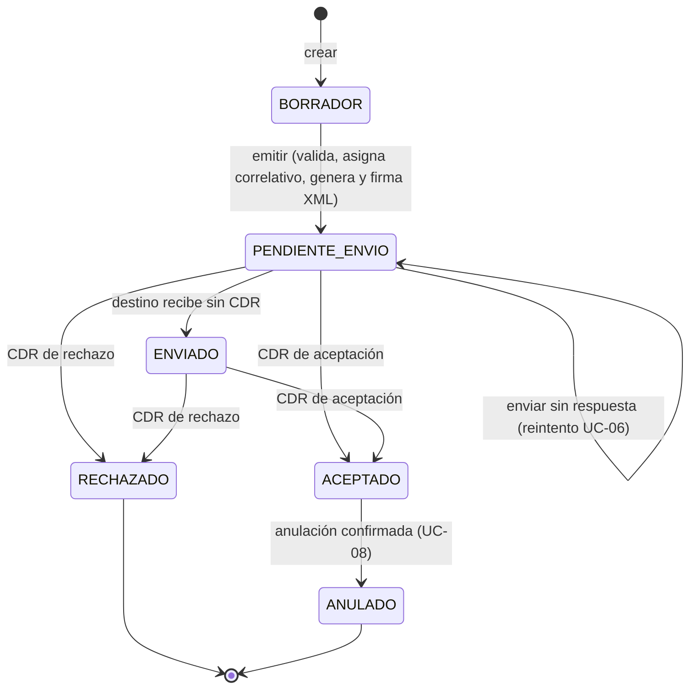
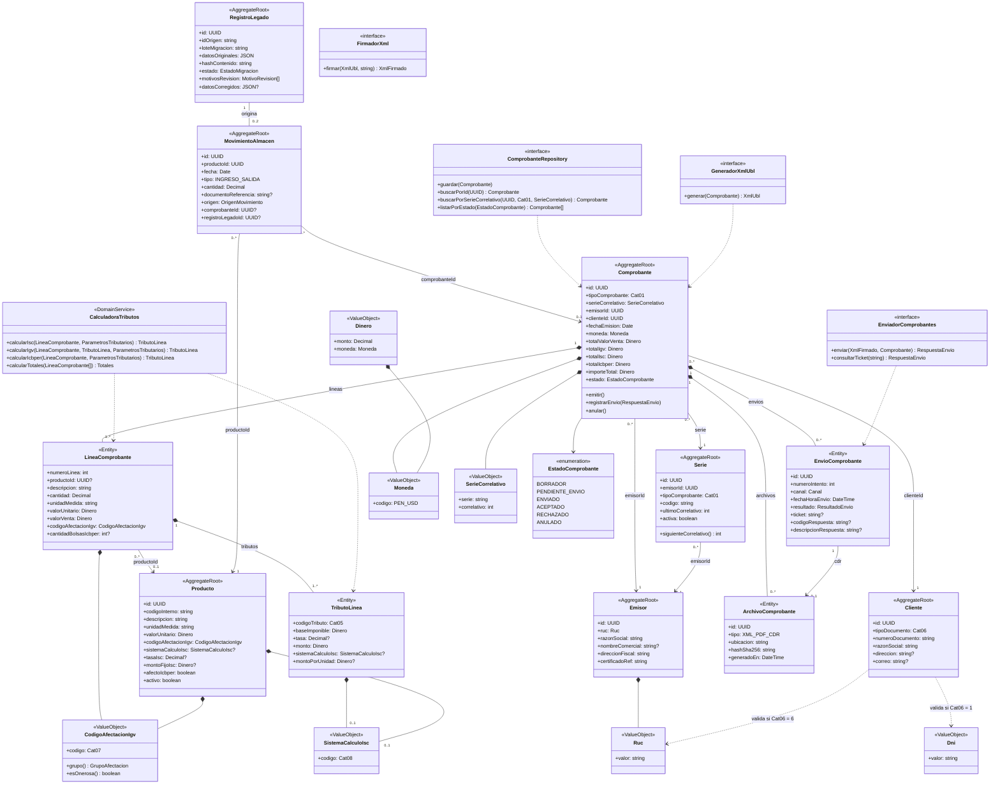

# Modelo de dominio — Facturación electrónica ABC Software Corp

- **ID**: `DOM-001`
- **Status**: `Draft`
- **Owner / Author**: `Campos Flores Elida Andrea`
- **Created**: `2026-10-22`
- **Last Updated**: `2026-10-22`
- **Relacionado con**: `specs/features/001-emitir-factura.md`, `specs/domain/catalogos-sunat.md`, `specs/domain/mapeo-legado.md`, UC-01, UC-05, UC-06, UC-08, UC-09, UC-10, UC-11, UC-13, UC-16, UC-17.

---

## 0. Convenciones

- El modelo de dominio usa nombres en **español**. Los DTOs de la API (`specs/contracts/schemas/`) usan inglés `camelCase`; la correspondencia se indica en la sección 8.
- Tipos usados: `UUID`, `string`, `int`, `Decimal` (precisión exacta, nunca coma flotante), `Date` (ISO 8601 `YYYY-MM-DD`), `Time`, `DateTime` (ISO 8601 con zona horaria), `JSON`, `enum`. Sufijo `?` = opcional; `[]` = colección.
- Los elementos UBL se citan con prefijo `cbc:` / `cac:` / `ext:`. Todos los elementos citados fueron confirmados contra `specs/reference/ubl-2.1/` (sección 9). Los que **no** existen en esos XSD se marcan con ⚠️.
- La obligatoriedad que impone SUNAT puede ser más estricta que la del XSD UBL (p. ej. `cbc:InvoiceTypeCode` es `minOccurs="0"` en el XSD). Esas diferencias se indican como **Pendiente de verificar** contra la guía de elaboración SUNAT.

### Agregados

| Agregado | Raíz | Entidades internas | Referencia a otros agregados |
|----------|------|--------------------|------------------------------|
| Comprobante | `Comprobante` | `LineaComprobante`, `TributoLinea`, `EnvioComprobante`, `ArchivoComprobante` | `Emisor`, `Cliente`, `Serie`, `Producto` (por id) |
| Emisor | `Emisor` | — | — |
| Cliente | `Cliente` | — | — |
| Producto | `Producto` | — | — |
| Serie | `Serie` | — | `Emisor` (por id) |
| Almacén | `MovimientoAlmacen` | — | `Producto`, `Comprobante`, `RegistroLegado` (por id) |
| Migración | `RegistroLegado` | — | `MovimientoAlmacen` (por id) |

Solo la raíz `Comprobante` puede modificar sus líneas, tributos, envíos y archivos. Entre agregados se referencia por identificador, nunca por objeto, para que cada agregado pueda extraerse a un servicio propio en la evolución hacia hexagonal/microservicios.

---

## 1. Entidades

### 1.1 Emisor

ABC Software Corp como contribuyente emisor (`cac:AccountingSupplierParty/cac:Party`).

| Atributo | Tipo | Descripción | Catálogo / elemento UBL |
|----------|------|-------------|-------------------------|
| `id` | `UUID` | Identificador interno. | — |
| `ruc` | `Ruc` | RUC del emisor. | Cat. 06 código `6` en `@schemeID` de `cac:AccountingSupplierParty/cac:Party/cac:PartyIdentification/cbc:ID` (Guía XML Factura UBL 2.1, numeral 16). Antes: **Pendiente de verificar**. |
| `razonSocial` | `string` | Nombre legal. | `cac:Party/cac:PartyLegalEntity/cbc:RegistrationName` (guía, numeral 15) |
| `nombreComercial` | `string?` | Nombre comercial. | `cac:Party/cac:PartyName/cbc:Name` |
| `direccionFiscal` | `string` | Domicilio fiscal. | `cac:PartyLegalEntity/cac:RegistrationAddress/cbc:AddressTypeCode` (código de domicilio fiscal o anexo, `0000` = domicilio fiscal; guía, numeral 17). Dirección completa y ubigeo: **Pendiente de verificar**. |
| `certificadoRef` | `string` | Referencia al certificado digital en un almacén seguro. Nunca contiene el certificado ni su clave. | Usado por `FirmadorXml`. |

### 1.2 Cliente

Adquirente (`cac:AccountingCustomerParty/cac:Party`). UC-09.

| Atributo | Tipo | Descripción | Catálogo / elemento UBL |
|----------|------|-------------|-------------------------|
| `id` | `UUID` | Identificador interno. | — |
| `tipoDocumento` | `enum Cat06` | `0`, `1`, `4`, `6`, `7`. | Cat. 06 en `@schemeID` de `cac:AccountingCustomerParty/cac:Party/cac:PartyIdentification/cbc:ID` (guía, numeral 18) |
| `numeroDocumento` | `string` | Validado como `Ruc` si tipo `6`, como `Dni` si tipo `1`. Formato de tipos `0`, `4`, `7`: **Pendiente de verificar**. | `cac:PartyIdentification/cbc:ID` |
| `razonSocial` | `string` | Nombre o razón social. | `cac:PartyLegalEntity/cbc:RegistrationName` (guía, numeral 19) |
| `direccion` | `string?` | Dirección. | `cac:PartyLegalEntity/cac:RegistrationAddress`. Obligatoriedad: **Pendiente de verificar**. |
| `correo` | `string?` | Correo para envío de la representación impresa. | — (no UBL) |

### 1.3 Producto

Bien comercializado. UC-10.

| Atributo | Tipo | Descripción | Catálogo / elemento UBL |
|----------|------|-------------|-------------------------|
| `id` | `UUID` | Identificador interno. | — |
| `codigoInterno` | `string` | Código propio del producto. Clave de búsqueda en la migración. | `cac:Item/cac:SellersItemIdentification/cbc:ID` |
| `descripcion` | `string` | Descripción comercial. | `cac:Item/cbc:Description` |
| `unidadMedida` | `string` | Unidad de venta. | `@unitCode` de `cbc:InvoicedQuantity`. Catálogo SUNAT de unidades: **Pendiente de verificar**. |
| `codigoProductoSunat` | `string?` | Clasificación del producto. | `cac:Item/cac:CommodityClassification/cbc:ItemClassificationCode`. Catálogo y obligatoriedad: **Pendiente de verificar**. |
| `valorUnitario` | `Dinero` | Valor unitario sin impuestos. | `cac:InvoiceLine/cac:Price/cbc:PriceAmount` |
| `codigoAfectacionIgv` | `CodigoAfectacionIgv` | Afectación IGV por defecto. | Cat. 07 en `cbc:TaxExemptionReasonCode` |
| `sistemaCalculoIsc` | `SistemaCalculoIsc?` | Presente solo si el producto está afecto al ISC. | Cat. 08 en `cbc:TierRange` |
| `tasaIsc` | `Decimal?` | Tasa ISC para sistemas `01` y `03`. Valores: **Pendiente de verificar**. | `cbc:Percent` del subtotal ISC; ubicación exacta: **Pendiente de verificar**. |
| `montoFijoIsc` | `Dinero?` | Monto por unidad para sistema `02`. Valores: **Pendiente de verificar**. | — |
| `afectoIcbper` | `boolean` | `true` si es bolsa plástica. | Cat. 05 código `7152` |
| `activo` | `boolean` | Productos inactivos no se pueden vender. | — |

### 1.4 Serie

Serie de numeración por tipo de comprobante. UC-11.

| Atributo | Tipo | Descripción | Catálogo / elemento UBL |
|----------|------|-------------|-------------------------|
| `id` | `UUID` | Identificador interno. | — |
| `emisorId` | `UUID` | Emisor propietario. | — |
| `tipoComprobante` | `enum Cat01` | `01` para factura. | Cat. 01 en `cbc:InvoiceTypeCode` |
| `codigo` | `string` | `F` + 3 alfanuméricos para factura (p. ej. `F001`). | Parte de `cbc:ID` del comprobante |
| `ultimoCorrelativo` | `int` | Último correlativo asignado (0 si ninguno). Máximo 99 999 999. | Parte de `cbc:ID` del comprobante |
| `activa` | `boolean` | Solo series activas emiten. | — |

### 1.5 Comprobante (raíz del agregado)

Comprobante de pago electrónico. En esta fase, factura (Cat. 01 `01`). Documento UBL: `Invoice` (`maindoc/UBL-Invoice-2.1.xsd`).

| Atributo | Tipo | Descripción | Catálogo / elemento UBL |
|----------|------|-------------|-------------------------|
| `id` | `UUID` | Identificador interno. | — |
| `tipoComprobante` | `enum Cat01` | `01` = factura. | Cat. 01 en `cbc:InvoiceTypeCode` |
| `serieCorrelativo` | `SerieCorrelativo` | Serie + correlativo. | `Invoice/cbc:ID`. Formato de concatenación: **Pendiente de verificar**. |
| `emisorId` | `UUID` | Emisor. | `cac:AccountingSupplierParty` |
| `clienteId` | `UUID` | Cliente. | `cac:AccountingCustomerParty` |
| `datosCliente` | `{tipoDocumento, numeroDocumento, razonSocial}` | Copia inmutable de los datos del cliente a la fecha de emisión, para que cambios posteriores del maestro no alteren el comprobante. | `cac:AccountingCustomerParty/cac:Party/...` |
| `fechaEmision` | `Date` | Fecha de emisión. | `cbc:IssueDate` |
| `horaEmision` | `Time` | Hora de emisión `hh:mm:ss`. | `cbc:IssueTime`. Obligatorio (guía, numeral 7). |
| `moneda` | `Moneda` | Moneda única del comprobante. | `cbc:DocumentCurrencyCode` y `@currencyID` de cada importe |
| `lineas` | `LineaComprobante[]` | Al menos una. | `cac:InvoiceLine` (`minOccurs="1"`) |
| `totalValorVenta` | `Dinero` | Suma de `valorVenta` de las líneas. | `cac:LegalMonetaryTotal/cbc:LineExtensionAmount` |
| `totalBaseImponibleIgv` | `Dinero` | Suma de bases IGV (incluye ISC). | `cac:TaxTotal/cac:TaxSubtotal/cbc:TaxableAmount` (subtotal con Cat. 05 `1000`) |
| `totalIgv` | `Dinero` | Suma de IGV. | `cac:TaxTotal/cac:TaxSubtotal/cbc:TaxAmount` (Cat. 05 `1000`) |
| `totalIsc` | `Dinero` | Suma de ISC (0 si no aplica). | `cac:TaxTotal/cac:TaxSubtotal/cbc:TaxAmount` (Cat. 05 `2000`) |
| `totalIcbper` | `Dinero` | Suma de ICBPER (0 si no aplica). | `cac:TaxTotal/cac:TaxSubtotal/cbc:TaxAmount` (Cat. 05 `7152`) |
| `totalTributos` | `Dinero` | Suma de todos los tributos. | `cac:TaxTotal/cbc:TaxAmount` |
| `importeTotal` | `Dinero` | Total a pagar. | `cac:LegalMonetaryTotal/cbc:PayableAmount`. Relación con `cbc:TaxInclusiveAmount` y descuentos/cargos: **Pendiente de verificar**. |
| `estado` | `EstadoComprobante` | Ver sección 3. | — |
| `envios` | `EnvioComprobante[]` | Historial de intentos de envío. | — |
| `archivos` | `ArchivoComprobante[]` | PDF, XML y CDR. | — |
| `creadoEn` / `actualizadoEn` | `DateTime` | Auditoría. | — |

### 1.6 LineaComprobante

| Atributo | Tipo | Descripción | Catálogo / elemento UBL |
|----------|------|-------------|-------------------------|
| `numeroLinea` | `int` | Consecutivo desde 1. | `cac:InvoiceLine/cbc:ID` |
| `productoId` | `UUID?` | Producto del catálogo, si existe. | — |
| `codigoProducto` | `string?` | Código interno del producto. | `cac:Item/cac:SellersItemIdentification/cbc:ID` |
| `descripcion` | `string` | Descripción. | `cac:Item/cbc:Description` |
| `cantidad` | `Decimal` | Mayor que 0. | `cbc:InvoicedQuantity` |
| `unidadMedida` | `string` | Unidad. | `cbc:InvoicedQuantity/@unitCode`. Catálogo: **Pendiente de verificar**. |
| `valorUnitario` | `Dinero` | Valor unitario sin impuestos. | `cac:Price/cbc:PriceAmount` |
| `valorVenta` | `Dinero` | `cantidad × valorUnitario`. Descuentos: **Pendiente de verificar**. | `cac:InvoiceLine/cbc:LineExtensionAmount` |
| `codigoAfectacionIgv` | `CodigoAfectacionIgv` | Afectación IGV de la línea. | Cat. 07 en `cac:InvoiceLine/cac:TaxTotal/cac:TaxSubtotal/cac:TaxCategory/cbc:TaxExemptionReasonCode` |
| `cantidadBolsasIcbper` | `int?` | Solo si la línea es de bolsas plásticas. | Cat. 05 `7152` |
| `tributos` | `TributoLinea[]` | Tributos calculados de la línea. | `cac:InvoiceLine/cac:TaxTotal/cac:TaxSubtotal` |
| `totalTributosLinea` | `Dinero` | Suma de `tributos[].monto`. | `cac:InvoiceLine/cac:TaxTotal/cbc:TaxAmount` |
| `precioUnitario` | `Dinero` | Precio unitario con impuestos. | `cac:InvoiceLine/cac:PricingReference/cac:AlternativeConditionPrice/cbc:PriceAmount` con `cbc:PriceTypeCode` `01` (Cat. 16). Obligatorio (guía, numeral 38). |

### 1.7 TributoLinea

Un `cac:TaxSubtotal` dentro de `cac:InvoiceLine/cac:TaxTotal`.

| Atributo | Tipo | Descripción | Catálogo / elemento UBL |
|----------|------|-------------|-------------------------|
| `codigoTributo` | `enum Cat05` | `1000` IGV, `2000` ISC, `7152` ICBPER, `9995`–`9998`. | Cat. 05 en `cac:TaxCategory/cac:TaxScheme/cbc:ID` |
| `baseImponible` | `Dinero` | Base de cálculo. | `cac:TaxSubtotal/cbc:TaxableAmount` |
| `tasa` | `Decimal?` | Porcentaje (p. ej. 18 para IGV). | `cbc:Percent` (existe en `cac:TaxSubtotal` y en `cac:TaxCategory`); ubicación exigida por SUNAT: **Pendiente de verificar**. |
| `monto` | `Dinero` | Importe del tributo. | `cac:TaxSubtotal/cbc:TaxAmount` |
| `codigoAfectacionIgv` | `CodigoAfectacionIgv?` | Solo para el subtotal IGV / exonerado / inafecto / exportación. | Cat. 07 en `cac:TaxCategory/cbc:TaxExemptionReasonCode` |
| `sistemaCalculoIsc` | `SistemaCalculoIsc?` | Obligatorio si `codigoTributo = 2000`. | Cat. 08 en `cac:TaxCategory/cbc:TierRange` |
| `cantidadUnidades` | `int?` | Solo ICBPER: número de bolsas. | Elemento: **Pendiente de verificar**. |
| `montoPorUnidad` | `Dinero?` | Solo ICBPER. Valor: **Pendiente de verificar**. | `cac:TaxSubtotal/cac:TaxCategory/cbc:PerUnitAmount` (RS 150-2019, Anexo I). |

### 1.8 EnvioComprobante

Un intento de envío a SUNAT u OSE/PSE y su respuesta. UC-05, UC-06.

| Atributo | Tipo | Descripción | Catálogo / elemento UBL |
|----------|------|-------------|-------------------------|
| `id` | `UUID` | Identificador interno. | — |
| `numeroIntento` | `int` | 1, 2, 3… | — |
| `canal` | `enum {SUNAT_DIRECTO, OSE_PSE}` | Destino del envío. | — |
| `fechaHoraEnvio` | `DateTime` | Momento del intento. | — |
| `resultado` | `enum {SIN_RESPUESTA, RECIBIDO, ACEPTADO, RECHAZADO}` | `RECIBIDO` = el destino recibió el documento pero aún no hay CDR (p. ej. ticket). | — |
| `ticket` | `string?` | Identificador de procesamiento asíncrono, si el canal lo devuelve. | — |
| `codigoRespuesta` | `string?` | Código del CDR. | `ApplicationResponse/cac:DocumentResponse/cac:Response/cbc:ResponseCode` (XSD: `0..1`). Valores de aceptación/rechazo: **Pendiente de verificar**. |
| `descripcionRespuesta` | `string?` | Mensaje del CDR. | `ApplicationResponse/cac:DocumentResponse/cac:Response/cbc:Description` (XSD: `0..n`). |
| `comprobanteReferido` | `string?` | Serie-correlativo del comprobante al que responde el CDR; debe coincidir con `Comprobante.serieCorrelativo`. | `ApplicationResponse/cac:DocumentResponse/cac:DocumentReference/cbc:ID` (XSD: `1..1`). |
| `observaciones` | `string[]` | Observaciones del CDR. | `ApplicationResponse/cbc:Note` (XSD: `0..n`). Que SUNAT ubique ahí las observaciones: **Pendiente de verificar**. |
| `archivoCdrId` | `UUID?` | Archivo CDR recibido. | — |
| `detalleError` | `string?` | Error técnico (timeout, conexión). Sin credenciales. | — |

> **CDR**: el CDR es un documento `ApplicationResponse`, verificado contra `specs/reference/ubl-2.1/maindoc/UBL-ApplicationResponse-2.1.xsd`. Estructura confirmada: `ApplicationResponse/cac:DocumentResponse` (`0..n`) → `cac:Response` (`1..1`) → `cbc:ResponseCode` (`0..1`) y `cbc:Description` (`0..n`); `cac:DocumentResponse/cac:DocumentReference/cbc:ID` (`1..n` / `1..1`). Los valores de `cbc:ResponseCode` que usa SUNAT y la obligatoriedad SUNAT de estos elementos: **Pendiente de verificar**.

### 1.9 ArchivoComprobante

Archivo asociado al comprobante. UC-13, UC-14.

| Atributo | Tipo | Descripción |
|----------|------|-------------|
| `id` | `UUID` | Identificador interno. |
| `tipo` | `enum {XML, PDF, CDR}` | XML firmado, representación impresa o constancia de recepción. |
| `formatoPdf` | `enum {A4, TICKET}?` | Solo para `PDF` (UC-15). |
| `ubicacion` | `string` | Referencia en el almacenamiento (no el contenido). |
| `hashSha256` | `string` | Huella del archivo para verificar integridad. |
| `tamanoBytes` | `int` | Tamaño. |
| `generadoEn` | `DateTime` | Fecha de generación o recepción. |

Plazo de conservación: **Pendiente de verificar** (UC-14).

### 1.10 MovimientoAlmacen

Ingreso o salida de mercadería. UC-17; destino principal de la migración (UC-16). No tiene correspondencia UBL.

| Atributo | Tipo | Descripción |
|----------|------|-------------|
| `id` | `UUID` | Identificador interno. |
| `productoId` | `UUID` | Producto movido. |
| `fecha` | `Date` | Fecha del movimiento. |
| `tipo` | `enum {INGRESO, SALIDA}` | Sentido. |
| `cantidad` | `Decimal` | Mayor que 0. |
| `documentoReferencia` | `string?` | Documento interno (en migración: `nro_documento` legado sin alterar). |
| `origen` | `enum {SISTEMA, COMPROBANTE, MIGRACION}` | Cómo se generó. |
| `comprobanteId` | `UUID?` | Si `origen = COMPROBANTE`. |
| `registroLegadoId` | `UUID?` | Obligatorio si `origen = MIGRACION`. |

### 1.11 RegistroLegado

Copia fiel de cada fila del sistema básico de almacén. Ver `specs/domain/mapeo-legado.md`.

| Atributo | Tipo | Descripción |
|----------|------|-------------|
| `id` | `UUID` | Identificador interno. |
| `idOrigen` | `string` | Id de la fila en el sistema legado; si no existe, `archivo + número de fila`. |
| `loteMigracion` | `string` | Identificador de la ejecución de migración. |
| `datosOriginales` | `JSON` | `{fecha, ingreso, salida, producto, nro_documento}` exactamente como se leyeron (texto sin transformar). Inmutable. |
| `hashContenido` | `string` | SHA-256 de `datosOriginales`. |
| `estado` | `enum {MIGRADO, PENDIENTE_REVISION}` | Nunca se elimina ni se descarta. |
| `motivosRevision` | `enum[]` | `PRODUCTO_INEXISTENTE`, `DOCUMENTO_DUPLICADO`, `FECHA_INVALIDA`, `CANTIDAD_INVALIDA`, `SIN_MOVIMIENTO`. |
| `datosCorregidos` | `JSON?` | Corrección manual aplicada en la revisión; no reemplaza `datosOriginales`. |
| `importadoEn` | `DateTime` | Fecha de importación. |
| `revisadoPor` / `revisadoEn` | `string?` / `DateTime?` | Auditoría de la revisión. |

---

## 2. Objetos de valor

Inmutables, comparados por valor, validan en su construcción (no puede existir una instancia inválida).

| Objeto de valor | Estructura | Invariante | Catálogo / elemento UBL |
|-----------------|-----------|------------|-------------------------|
| `Ruc` | `valor: string` | 11 dígitos numéricos con dígito verificador válido. Algoritmo del dígito verificador: **Pendiente de verificar**. | Cat. 06 código `6`; `cac:PartyIdentification/cbc:ID` con `@schemeID="6"` |
| `Dni` | `valor: string` | 8 dígitos numéricos. | Cat. 06 código `1`; `cac:PartyIdentification/cbc:ID` con `@schemeID="1"` |
| `Moneda` | `codigo: enum {PEN, USD}` | Solo códigos ISO 4217 aportados. | `cbc:DocumentCurrencyCode`; `@currencyID` de los importes |
| `SerieCorrelativo` | `serie: string`, `correlativo: int` | Factura: serie `^F[A-Z0-9]{3}$`; correlativo 1–99 999 999 (hasta 8 dígitos). Mayúsculas/minúsculas en la serie: **Pendiente de verificar**. | `Invoice/cbc:ID`. Formato `serie-correlativo`: **Pendiente de verificar**. |
| `Dinero` | `monto: Decimal`, `moneda: Moneda` | Operaciones solo entre la misma moneda. Escala y redondeo: **Pendiente de verificar**. | Cualquier `cbc:*Amount` con `@currencyID` |
| `CodigoAfectacionIgv` | `codigo: enum Cat07` | Uno de `10`–`17`, `20`, `21`, `30`–`36`, `40`. Expone `grupo()` (GRAVADO 1x, EXONERADO 2x, INAFECTO 3x, EXPORTACION 40) y `esOnerosa()` (10, 17, 20, 30, 40). | Cat. 07 en `cac:TaxCategory/cbc:TaxExemptionReasonCode` |
| `SistemaCalculoIsc` | `codigo: enum Cat08` | Uno de `01` (al valor), `02` (monto fijo), `03` (precio de venta al público). | Cat. 08 en `cac:TaxCategory/cbc:TierRange` |

---

## 3. Estados del comprobante

| Estado | Significado |
|--------|-------------|
| `BORRADOR` | Datos en preparación. Sin correlativo asignado ni XML. Editable. |
| `PENDIENTE_ENVIO` | Validado, con correlativo asignado, XML UBL generado y firmado. Aún sin respuesta del destino (no enviado o sin respuesta). |
| `ENVIADO` | El destino recibió el documento; CDR aún no disponible (p. ej. procesamiento por ticket). |
| `ACEPTADO` | CDR de aceptación recibido. Las observaciones del CDR se registran sin cambiar el estado. |
| `RECHAZADO` | CDR de rechazo recibido. Estado final. |
| `ANULADO` | Anulación comunicada y confirmada (UC-08). Estado final. |

| Desde | Hacia | Disparador | Condición |
|-------|-------|-----------|-----------|
| — | `BORRADOR` | Crear | — |
| `BORRADOR` | `PENDIENTE_ENVIO` | Emitir | Se cumplen INV-01 a INV-12; correlativo asignado; XML generado y firmado. |
| `PENDIENTE_ENVIO` | `PENDIENTE_ENVIO` | Envío sin respuesta | Se registra `EnvioComprobante` con `SIN_RESPUESTA`. |
| `PENDIENTE_ENVIO` | `ENVIADO` | Destino confirma recepción sin CDR | Se registra `ticket` si existe. |
| `PENDIENTE_ENVIO` / `ENVIADO` | `ACEPTADO` | CDR de aceptación | Existe CDR almacenado como `ArchivoComprobante` tipo `CDR`. |
| `PENDIENTE_ENVIO` / `ENVIADO` | `RECHAZADO` | CDR de rechazo | Existe CDR almacenado. |
| `ACEPTADO` | `ANULADO` | Anulación confirmada | Procedimiento (comunicación de baja), plazos y condiciones: **Pendiente de verificar** (UC-08). |

Cualquier otra transición se rechaza. En particular: nunca `→ ACEPTADO` sin CDR (FR-10); nunca `→ BORRADOR` desde otro estado; `RECHAZADO` y `ANULADO` son finales. Si el correlativo de un comprobante rechazado puede reutilizarse: **Pendiente de verificar** (por defecto, no se reutiliza).

---

## 4. Reglas de dominio (invariantes)

| ID | Regla | Catálogo SUNAT | Elemento UBL |
|----|-------|----------------|--------------|
| INV-01 | Una factura tiene tipo de comprobante `01`. Aunque el XSD declara `cbc:InvoiceTypeCode` con `minOccurs="0"`, se trata como obligatorio; obligatoriedad SUNAT: **Pendiente de verificar**. | Cat. 01 | `cbc:InvoiceTypeCode` |
| INV-02 | El cliente de una factura se identifica con RUC válido (`Ruc`). | Cat. 06 código `6` | `cac:AccountingCustomerParty/cac:Party/cac:PartyIdentification/cbc:ID/@schemeID` |
| INV-03 | El emisor se identifica con RUC válido. | Cat. 06 código `6` (uso en emisor: **Pendiente de verificar**) | `cac:AccountingSupplierParty/cac:Party/cac:PartyIdentification/cbc:ID` |
| INV-04 | La serie corresponde al tipo de comprobante (factura: `F` + 3 alfanuméricos), está activa y pertenece al emisor. El correlativo tiene hasta 8 dígitos. La combinación (emisor, tipo, serie, correlativo) es única. Secuencia sin huecos y unicidad normativa: **Pendiente de verificar**. | Cat. 01 | `cbc:ID` |
| INV-05 | Moneda `PEN` o `USD`, única para todo el comprobante: todos los importes usan la misma `Moneda`. | ISO 4217 (aportado en catálogos) | `cbc:DocumentCurrencyCode`, `@currencyID` |
| INV-06 | El comprobante tiene al menos una línea; `cantidad > 0`; `valorUnitario ≥ 0`. | — | `cac:InvoiceLine` (`minOccurs="1"`), `cbc:InvoicedQuantity`, `cac:Price/cbc:PriceAmount` |
| INV-07 | Cada línea tiene un código de afectación IGV existente en el Catálogo 07. | Cat. 07 | `cac:InvoiceLine/cac:TaxTotal/cac:TaxSubtotal/cac:TaxCategory/cbc:TaxExemptionReasonCode` |
| INV-08 | Si una línea tiene ISC, debe tener sistema de cálculo del Catálogo 08 y su tributo se identifica con Cat. 05 `2000`. ISC sin sistema = inválido. | Cat. 08, Cat. 05 `2000` | `cac:TaxCategory/cbc:TierRange`, `cac:TaxScheme/cbc:ID` |
| INV-09 | Base IGV de la línea = `valorVenta + ISC`. Para Cat. 07 `10`, IGV = Base IGV × 18 %, identificado con Cat. 05 `1000`. Tratamiento de códigos `11`–`17` (gratuitas e IVAP): **Pendiente de verificar**. | Cat. 07, Cat. 08, Cat. 05 `1000` | `cac:TaxSubtotal/cbc:TaxableAmount`, `cac:TaxSubtotal/cbc:TaxAmount`, `cac:TaxScheme/cbc:ID` |
| INV-10 | Líneas exoneradas, inafectas o de exportación (Cat. 07 grupos 2x, 3x, `40`) no generan IGV. Correspondencia con los códigos `9997`, `9998`, `9995` del Cat. 05: **Pendiente de verificar**. | Cat. 07, Cat. 05 | `cac:TaxScheme/cbc:ID` |
| INV-11 | Si una línea es de bolsas plásticas, incluye un tributo ICBPER con Cat. 05 `7152` y `cantidadUnidades > 0`. Monto por unidad: **Pendiente de verificar**. | Cat. 05 `7152` | `cac:TaxScheme/cbc:ID`; `cac:TaxCategory/cbc:PerUnitAmount` (tasa) y `cac:TaxSubtotal/cbc:BaseUnitMeasure` (cantidad de bolsas) |
| INV-12 | Totales del comprobante = suma de los valores de sus líneas por tributo; `importeTotal = totalValorVenta + totalTributos`. Redondeo, descuentos y cargos: **Pendiente de verificar**. | Cat. 05 | `cac:TaxTotal/cbc:TaxAmount`, `cac:LegalMonetaryTotal/cbc:LineExtensionAmount`, `cac:LegalMonetaryTotal/cbc:PayableAmount` |
| INV-13 | Fuera de `BORRADOR`, el contenido tributario (líneas, cliente, moneda, totales) es inmutable; solo cambian estado, envíos y archivos. *Regla de diseño, no normativa.* | — | — |
| INV-14 | Solo se envía un XML firmado. Contenido y algoritmo de firma: fuera de alcance (feature futura). | — | `ext:UBLExtensions`, `cac:Signature` (`minOccurs="0"` en el XSD; obligatoriedad SUNAT: **Pendiente de verificar**) |
| INV-15 | `ACEPTADO` y `RECHAZADO` requieren un CDR asociado (FR-10) cuyo `cac:DocumentReference/cbc:ID` coincida con la serie-correlativo del comprobante. El valor de `cbc:ResponseCode` que distingue aceptación de rechazo: **Pendiente de verificar**. | — | `ApplicationResponse/cac:DocumentResponse/cac:Response/cbc:ResponseCode`, `ApplicationResponse/cac:DocumentResponse/cac:DocumentReference/cbc:ID` |
| INV-16 | Solo se permiten las transiciones de la sección 3. | — | — |

---

## 5. Servicio de dominio y puertos

### 5.1 CalculadoraTributos (servicio de dominio)

Sin estado ni dependencias de infraestructura. Las tasas y montos los recibe como `ParametrosTributarios` (configuración verificada), nunca codificados en el dominio.

| Operación | Entrada | Salida | Regla |
|-----------|---------|--------|-------|
| `calcularIsc(linea, params)` | Línea con `SistemaCalculoIsc` | `TributoLinea?` (Cat. 05 `2000`) | `01`: `valorVenta × tasa`; `02`: `cantidad × montoFijo`; `03`: `precioVentaPublico × tasa` (descripción del Cat. 08). Si la línea trae el monto ISC ya informado, se usa ese monto. Tasas, montos y la base del sistema `03`: **Pendiente de verificar**. |
| `calcularIgv(linea, isc, params)` | Línea + ISC | `TributoLinea` (Cat. 05 `1000` o el que corresponda a INV-10) | Base = `valorVenta + ISC`; para Cat. 07 `10`: `IGV = base × 18 %`. Otros códigos: INV-09 / INV-10. |
| `calcularIcbper(linea, params)` | Línea con `cantidadBolsasIcbper` | `TributoLinea?` (Cat. 05 `7152`) | `cantidad × montoPorUnidad`. Monto: **Pendiente de verificar**. Si integra la base IGV: **Pendiente de verificar** (por defecto, no). |
| `calcularLinea(linea, params)` | Línea | `TributoLinea[]` | Orden obligatorio: ISC → IGV → ICBPER (el IGV depende del ISC). |
| `calcularTotales(lineas)` | `LineaComprobante[]` | Totales del comprobante | INV-12. |

### 5.2 Puertos (interfaces del dominio / aplicación)

| Puerto | Operaciones | Adaptadores previstos |
|--------|-------------|-----------------------|
| `ComprobanteRepository` | `guardar(comprobante)`, `buscarPorId(id)`, `buscarPorSerieCorrelativo(emisorId, tipo, serieCorrelativo)`, `listarPorEstado(estado)` (usado por UC-06 para `PENDIENTE_ENVIO`), `siguienteCorrelativo(serieId)` (atómico; mecanismo de concurrencia: **Pendiente de definir**). | TypeORM + PostgreSQL |
| `GeneradorXmlUbl` | `generar(comprobante): XmlUbl` — produce un `Invoice` conforme a `maindoc/UBL-Invoice-2.1.xsd` con las ubicaciones de la sección 1. | Generador XML propio |
| `FirmadorXml` | `firmar(xml, certificadoRef): XmlFirmado` — firma en `ext:UBLExtensions` y referencia en `cac:Signature`. | Firma XMLDSig/XAdES (detalle en feature futura) |
| `EnviadorComprobantes` | `enviar(xmlFirmado, comprobante): RespuestaEnvio`; `consultarTicket(ticket): RespuestaEnvio`. `RespuestaEnvio = {resultado, ticket?, codigoRespuesta?, descripcionRespuesta?, observaciones[], cdr?: bytes, detalleError?}`. | SUNAT directo; OSE/PSE Nubefact |

Los demás repositorios (`ClienteRepository`, `ProductoRepository`, `SerieRepository`, `MovimientoAlmacenRepository`, `RegistroLegadoRepository`) y el puerto de almacenamiento de archivos se definirán con el contrato API: **Pendiente de definir**.

Dependencias: `Controller (MVC) → Servicio de aplicación → {Comprobante, CalculadoraTributos} + puertos ← adaptadores`. El dominio no importa TypeORM, NestJS ni clientes HTTP.

---

## 6. Diagrama de clases

---

## 7. Relación con la migración

Los registros del legado **no** se convierten en `Comprobante`: el `nro_documento` legado es informal y nunca fue emitido ante SUNAT, por lo que no cumple el Cat. 01 ni el formato de `cbc:ID`. Cada fila se conserva como `RegistroLegado` y genera 0, 1 o 2 `MovimientoAlmacen`. Detalle en `specs/domain/mapeo-legado.md`.

## 8. Correspondencia dominio ↔ DTO

| Dominio (español) | DTO (`camelCase`) | Esquema |
|-------------------|-------------------|---------|
| `Cliente.tipoDocumento` / `numeroDocumento` / `razonSocial` | `documentType` / `documentNumber` / `legalName` | `customer.schema.json` |
| `SerieCorrelativo.serie` / `.correlativo` | `series` / `correlative` | `create-invoice.request.schema.json` |
| `Comprobante.moneda` | `currency` | request / response |
| `LineaComprobante.descripcion` / `cantidad` / `valorUnitario` | `description` / `quantity` / `unitSaleValue` | request |
| `LineaComprobante.codigoAfectacionIgv` | `igvAffectationCode` | request, `product.schema.json` |
| ISC de línea: `SistemaCalculoIsc`, tasa, monto | `iscSystem`, `iscRate`, `iscAmount` | request |
| `LineaComprobante.cantidadBolsasIcbper` | `icbperQuantity` | request |
| `Comprobante.tipoComprobante` | `documentType` | response |
| `totalBaseImponibleIgv` / `totalIgv` / `totalIsc` / `totalIcbper` / `importeTotal` | `totals.taxableBase` / `igvAmount` / `iscAmount` / `icbperAmount` / `totalAmount` | response |
| `Comprobante.estado` | `status` | response |

## 9. Verificación de elementos UBL contra `specs/reference/ubl-2.1/`

Verificado el 2026-10-22 comprobando la declaración de cada elemento en `common/UBL-CommonBasicComponents-2.1.xsd` / `common/UBL-CommonAggregateComponents-2.1.xsd` y su presencia como hijo del tipo padre (`InvoiceType`, `InvoiceLineType`, `TaxTotalType`, `TaxSubtotalType`, `TaxCategoryType`, `TaxSchemeType`, `PartyType`, `PartyIdentificationType`, `PartyLegalEntityType`, `PartyNameType`, `ItemType`, `ItemIdentificationType`, `CommodityClassificationType`, `PriceType`, `MonetaryTotalType`, `DocumentResponseType`, `ResponseType`).

| Elemento | Padre en XSD | Resultado |
|----------|-------------|-----------|
| `cbc:ID`, `cbc:IssueDate`, `cbc:IssueTime`, `cbc:InvoiceTypeCode`, `cbc:DocumentCurrencyCode`, `cbc:Note`, `ext:UBLExtensions`, `cac:Signature`, `cac:AccountingSupplierParty`, `cac:AccountingCustomerParty`, `cac:TaxTotal`, `cac:LegalMonetaryTotal`, `cac:InvoiceLine` | `Invoice` | ✅ Existe. `cbc:InvoiceTypeCode`, `cbc:DocumentCurrencyCode` y `cac:Signature` son `minOccurs="0"` en UBL. |
| `cbc:ID`, `cbc:InvoicedQuantity`, `cbc:LineExtensionAmount`, `cac:PricingReference`, `cac:TaxTotal`, `cac:Item`, `cac:Price` | `InvoiceLine` | ✅ |
| `cbc:TaxAmount`, `cac:TaxSubtotal` | `TaxTotal` | ✅ |
| `cbc:TaxableAmount`, `cbc:TaxAmount`, `cbc:Percent`, `cbc:PerUnitAmount`, `cbc:TierRange`, `cac:TaxCategory` | `TaxSubtotal` | ✅ |
| `cbc:Percent`, `cbc:TaxExemptionReasonCode`, `cbc:TierRange`, `cbc:PerUnitAmount`, `cac:TaxScheme` | `TaxCategory` | ✅ (`cbc:TierRange`, `cbc:Percent` y `cbc:PerUnitAmount` existen en ambos niveles; SUNAT usa `cac:TaxCategory` para `cbc:TierRange` según `catalogos-sunat.md`) |
| `cbc:ID` | `TaxScheme` | ✅ |
| `cac:PartyIdentification`, `cac:PartyName`, `cac:PartyLegalEntity` | `Party` | ✅ |
| `cbc:RegistrationName`, `cac:RegistrationAddress` | `PartyLegalEntity` | ✅ |
| `cbc:Description`, `cac:SellersItemIdentification`, `cac:CommodityClassification` | `Item` | ✅ |
| `cbc:ItemClassificationCode` | `CommodityClassification` | ✅ |
| `cbc:PriceAmount` | `Price` | ✅ |
| `cbc:LineExtensionAmount`, `cbc:TaxInclusiveAmount`, `cbc:PayableAmount` | `LegalMonetaryTotal` (`MonetaryTotalType`) | ✅ |
| `cac:Response`, `cac:DocumentReference`, `cbc:ResponseCode`, `cbc:Description` | `DocumentResponse` / `Response` | ✅ en `common/` |
| `cbc:ID`, `cbc:IssueDate`, `cbc:Note`, `cac:Signature`, `cac:SenderParty`, `cac:ReceiverParty`, `cac:DocumentResponse` | `ApplicationResponse` | ✅ (`maindoc/UBL-ApplicationResponse-2.1.xsd`, verificado el 2026-10-22) |
| `@schemeID`, `@currencyID`, `@unitCode` | `CCTS_CCT_SchemaModule-2.1.xsd` | ✅ |
| Documento `ApplicationResponse` (CDR) | `maindoc/` | ✅ `UBL-ApplicationResponse-2.1.xsd` agregado y verificado. |
